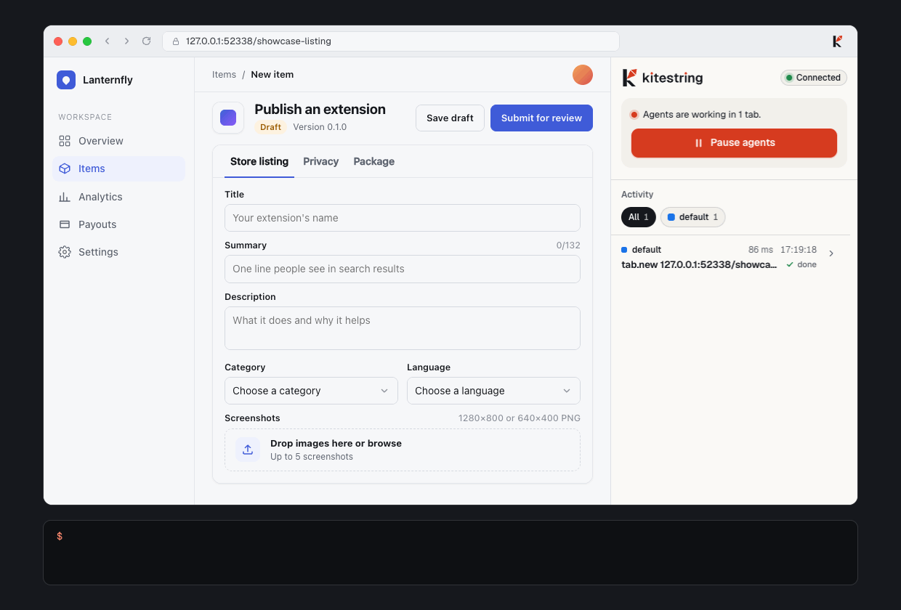
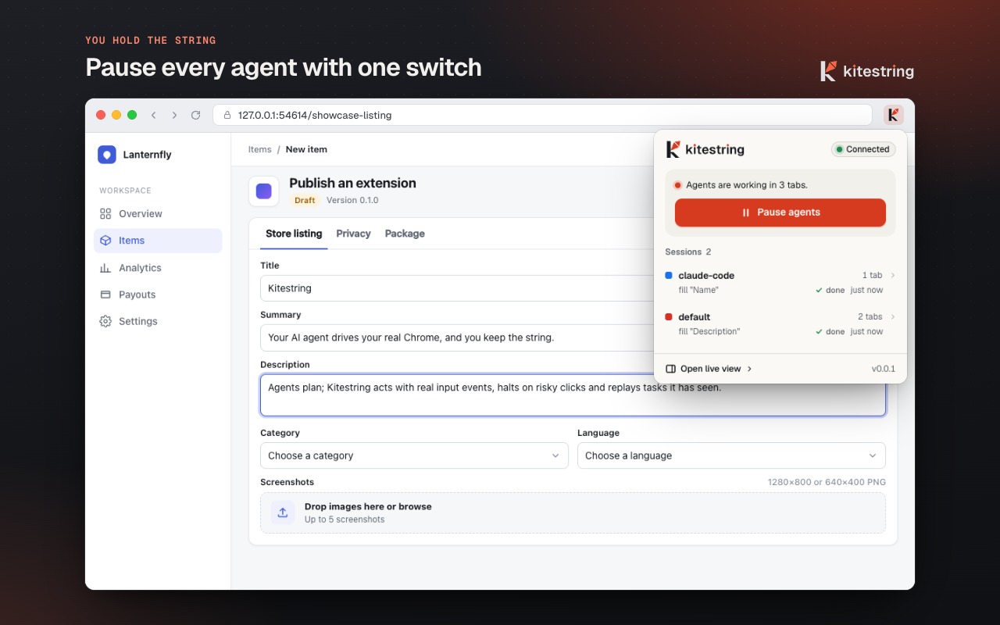
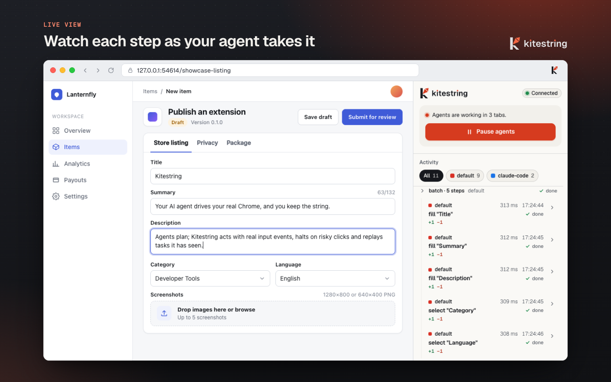
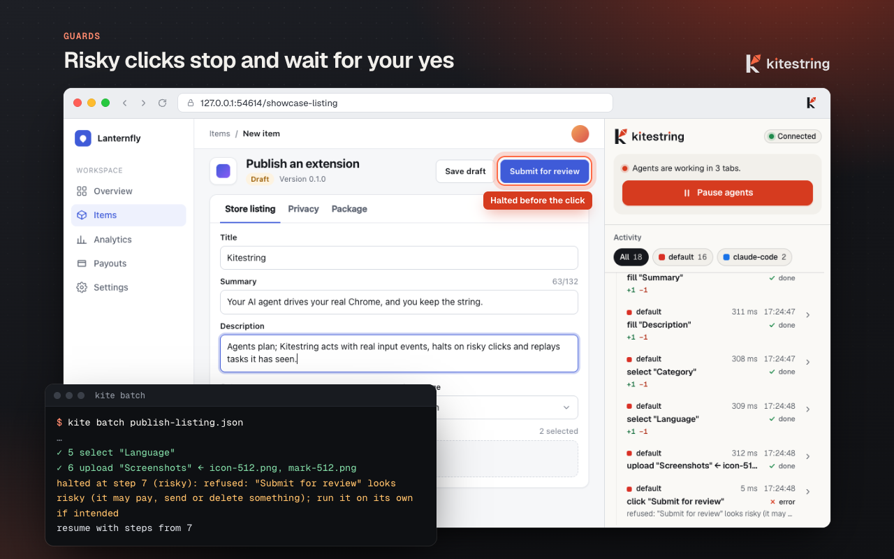
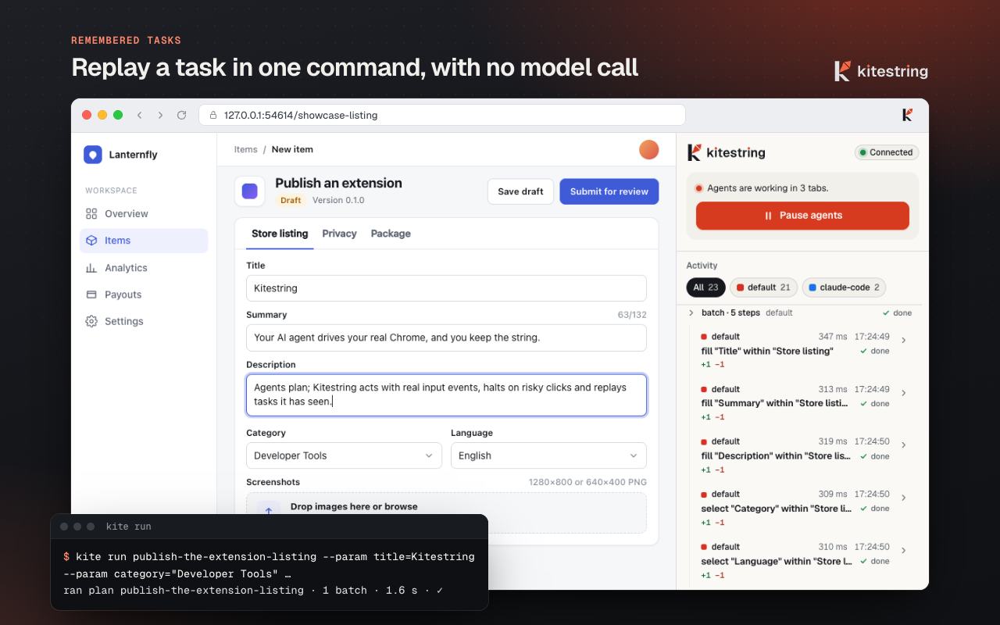
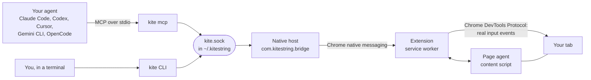
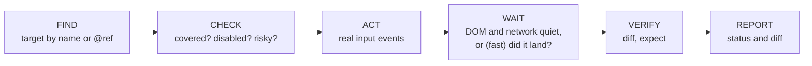

<div align="center">

<picture>
  <source media="(prefers-color-scheme: dark)" srcset="brand/lockup-dark.svg">
  
</picture>

<h3>Your AI agent drives your real Chrome. You hold the string.</h3>

<p>
  
  
  
  <a href="LICENSE"></a>
  
  
  
</p>

<p>
  <a href="#quickstart">Quickstart</a> ·
  <a href="#speed">Speed</a> ·
  <a href="#how-it-works">How it works</a> ·
  <a href="#safety-and-privacy">Safety</a> ·
  <a href="docs/reference.md">Reference</a> ·
  <a href="docs/troubleshooting.md">Troubleshooting</a>
</p>

</div>

<p align="center">
  
</p>

Kitestring is a Chrome extension, a command-line tool (`kite`) and an MCP server. Together they let the agent you
already use (Claude Code, Codex, Cursor, Gemini CLI or OpenCode) work in **your** Chrome, with your profile, your
logins and your tabs. Kitestring never calls a model itself: the agent plans, and Kitestring acts, guards, remembers
and replays.

> [!NOTE]
> Kitestring is a developer install for now. There is no Chrome Web Store listing yet; the store package is ready
> (see [Development](#development)). macOS and Linux are supported. The Windows code is written but untested.

## Why Kitestring

- **Your browser, not a fresh one.** Agents work in the Chrome you are signed in to, so there is no login dance and no
  separate profile to keep in sync.
- **Fast because it needs fewer turns.** Most of an agent's time in a browser goes to model turns, not clicks. With
  `browser_script` the agent writes a whole flow as code (loops, branches, reads) and runs it in one call: a GitHub
  flow that took ~22 s as a batch takes ~4 s. A task that worked before replays with one `kite run`.
- **Fast without being sloppy.** Fast steps skip the wait for the page to go idle, but every click checks that it
  landed. One that missed is sent again; one that may have done something is never sent twice.
- **Stops where it should.** Clicks on buttons such as pay, publish or submit for review halt the batch, and a
  Pause switch stops every agent at once.
- **Asks you when it is stuck.** At a captcha, a 2FA code, a password or a login, the agent asks you through a
  Chrome notification and waits, then carries on.
- **Keeps working when no agent is running.** Saved tasks replay on a schedule, watches tell you when a page
  changes, and exports save a page's rows to a file every day.
- **Nothing leaves your computer.** The extension talks only to the local `kite` program. No server, no account, no
  analytics.

## Features

<table>
<tr>
<td width="50%" valign="top">

### Scripts: a whole flow in one call
`browser_script` (`kite script`) runs JavaScript the agent writes: `goto`, `click`, `fill`, `waitFor`, `extract`,
`evaluate` and more, with loops and branches. A failed step throws with a code the script can catch. The code runs in
a locked-down Node process: no files, no subprocesses, no environment.

</td>
<td width="50%" valign="top">

### Clicks that prove they landed
A fast click re-checks its element right before the input, watches the press and looks for an effect. A press that
missed is sent again; a click before the app is listening waits for it. A click that may have done something is
never sent twice.

</td>
</tr>
<tr>
<td valign="top">

### Safe action pipeline
Every action runs **find → check → act → wait → verify**: it finds the target by its visible name, checks that
nothing covers it and that it is enabled, acts with real input events, waits, and reports what changed as a diff.

</td>
<td valign="top">

### Batches, normal or fast
Up to 50 steps in one call under one tab lock. A batch stops at the first step that does not work and says where
and why. `fast: true` waits for each step's target and `expect` instead of for the whole page to go idle.

</td>
</tr>
<tr>
<td valign="top">

### `waitFor` anything
Wait for a selector (visible, hidden, attached, detached), a target, text in a section or gone, a count of rows, a
URL, your own function run in the page, or idle. It resolves on the DOM change itself, survives navigations, and a
timeout says what it last saw.

</td>
<td valign="top">

### Guards
Dialogs, cookie walls and newsletter modals are handled. New tabs and popups join the session. A domain guard keeps
a run on its site. Risky clicks halt the batch, and so does an Enter or Space that would trigger one.

</td>
</tr>
<tr>
<td valign="top">

### Ask the human
`browser_ask_human` (`kite ask`) asks you to solve a captcha, enter a 2FA code or log in: a Chrome notification,
the toolbar badge and a card in the side panel. The agent waits, then picks up where it stopped.

</td>
<td valign="top">

### Tables and lists as rows
`browser_extract` (`kite extract`) reads search results, orders or cards as columns and rows with no snapshots,
pages through with `next`, and saves `.csv`, `.json` or `.jsonl`.

</td>
</tr>
<tr>
<td valign="top">

### Schedules, watches and exports
`kite schedule` replays a saved task on a timer while you are away. `kite watch` checks a page in the background
and notifies you of a real change. `kite export` saves a page's rows every day and says how many are new.

</td>
<td valign="top">

### Remembered tasks and recording
A batch that worked becomes a plan with `{{params}}` in place of every typed value; `kite run` replays it. Or
`kite record start`, do the task yourself, `kite record stop`: your agents get a skill. Values are never stored.

</td>
</tr>
<tr>
<td valign="top">

### File upload
Puts local files into a file input, a button that opens one, or a drop zone. A deny list refuses SSH keys,
cloud credentials, shell history, `.env` files and browser profiles before the browser is touched.

</td>
<td valign="top">

### Pause, popup and live view
The toolbar popup shows the connection, each agent session and a Pause switch. The side panel lists every action
as it happens, with its diff.

</td>
</tr>
</table>

## Speed

The time an agent spends in a browser is mostly model turns, one per tool call, so the way to go fast is fewer
calls. Measured in a real Chrome on live sites, the same read-only flow three ways (3 runs each):

| Flow | Default batch | `fast` batch | `browser_script` |
| --- | ---: | ---: | ---: |
| GitHub: repo → Issues → Pull requests → Code | ~22 s | ~9 s | **~4 s** |
| X: home → Explore → search → Latest → profile | 20–35 s | 4–6 s | **1.7–5.8 s** |
| Hacker News: three pages of "More" | 2.9–5.2 s | 2.0–2.8 s | **1.5–2.0 s** |

The difference is the wait after each step. A default step waits for the page to go idle (network and DOM quiet);
on a live site such as X or GitHub that never quite happens, so each step waits out most of its timeout. A fast step
waits for exactly what the next step needs instead: its target, its `expect`, or a `waitFor`.

Skipping that wait does not make it flaky. Twenty runs each of the X flow (median 2.9 s) and the GitHub flow (median
4.1 s), done as scripts that also read the results, all passed. That holds because every fast click checks that it
landed (see [How a fast click makes sure it landed](docs/reference.md#how-a-fast-click-makes-sure-it-landed)).

```js
// One browser_script call: search, wait for real posts (not the sidebar), read five.
await goto("https://x.com/explore")
await fill("Search query", "claude code")
await press("Enter", { expect: { url: "/search" } })
await click("Latest", { role: "tab" })
await waitFor({ count: { selector: "article [data-testid='tweetText']", min: 5 } })
return await evaluate(() => [...document.querySelectorAll("article [data-testid='tweetText']")].slice(0, 5).map((e) => e.innerText))
```

## Screenshots

<table>
<tr>
<td width="50%"></td>
<td width="50%"></td>
</tr>
<tr>
<td></td>
<td></td>
</tr>
</table>

The page in these images is `apps/torture/pages/showcase-listing.html`, a fictional developer console made for the
demo. The images are regenerated from real runs with `KITE_UPDATE_DOCS=1 pnpm test:e2e`.

## Quickstart

You need macOS or Linux, Node 22.12 or newer, pnpm, and Google Chrome or Chromium.

**1. Build**

```sh
git clone https://github.com/shivarajbakale/kitestring.git && cd kitestring
pnpm install && pnpm build
```

**2. Load the extension.** Open `chrome://extensions`, turn on **Developer mode**, click **Load unpacked** and pick
`packages/extension/build/chrome-mv3-prod`. The card should show the ID `bdfegcbeenjmlbfogodoibdhfbonnicm`.

**3. Connect your agents**

```sh
node packages/cli/dist/bin.js init
```

`kite init` adds the `kitestring` MCP server to every supported agent it finds, installs the three skills into
`~/.agents/skills` (with symlinks in `~/.claude/skills`), installs the native host, and writes a `kite` command to
`~/.kitestring/bin/kite`. It backs up each file it changes once, skips agents you do not have, never edits your
shell profile, and is safe to re-run. Use `--dry-run` to see the plan, `--agents claude-code,codex` to pick a subset
and `--yes` to skip the prompt. If it says `~/.kitestring/bin` is not on your `PATH`, add this line to your shell
profile and open a new terminal:

```sh
export PATH="$HOME/.kitestring/bin:$PATH"
```

**4. Check, then ask.** Reload the extension (or restart Chrome) and restart your agents, then run:

```sh
kite doctor
```

Start a new agent session and ask it to open a page in your browser. To undo the agent side, run
`kite uninstall-agents`.

## How it works



Chrome starts the native host when the extension connects; the host serves a local socket that `kite` and
`kite mcp` talk to. A `browser_script` runs in a child Node process with the permission model on (no files,
subprocesses, workers or environment) and reaches the browser only through its helpers, each a call on that socket. The extension's service worker owns sessions, tab groups, the pause switch and the activity log.
In each tab, the page agent reads the page as a compact tree with refs, finds targets by name, and diffs the page
before and after each action.

Each action goes through the same pipeline. A fast step (in a script, or a `fast` batch) replaces the idle wait and
the diff with a landing check: it waits for its own target and `expect`, and verifies that its click reached the
element.



## Safety and privacy

- **Pause.** Pause from the popup, the side panel or `kite pause` (`kite resume` to continue). An action in flight
  finishes or hits its time cap; queued and new requests are refused with `PAUSED`.
- **Risky halts.** A batch halts with `risky` before a click on a button named like pay, buy, place order, send,
  delete, publish, submit for review, transfer or confirm payment, and before an Enter or Space that would trigger
  one. Run that single click on its own when you mean it; your agent can ask you first.
- **One session, its own tabs.** Each agent session gets its own tab group, `kite:<session>`, and cannot act on
  another session's tabs.
- **Recorded tabs are off limits.** While you record, agents can neither act in that tab nor read it (snapshots,
  console, network, screenshots).
- **No values stored.** Remembered plans and recorded skills keep parameter names, never the values typed.
  Password and one-time-code values are never kept, not even as a hash.
- **Asks instead of guessing.** Captchas, 2FA codes, passwords and logins go to you through `browser_ask_human`;
  the skill tells agents never to type a secret themselves, not even one pasted into the chat.
- **Scripts are boxed in.** A `browser_script` gets no files, subprocesses, workers or environment variables (and,
  on Node 25 and later, no network), and it is killed at its deadline. Its clicks halt on risky buttons like any
  batch. `evaluate` runs in the page with the page's privileges and shows in the activity log; the skill tells
  agents to use it for reading only.
- **Nothing sent anywhere.** The extension talks only to the `kite` program on your computer, through native
  messaging. It has no server, account, analytics or model. Restricted pages (`chrome://`, the Chrome Web Store)
  are refused.

The full privacy policy is in [store/privacy.md](store/privacy.md); what the extension can access is in
[SECURITY.md](SECURITY.md).

## Remembered tasks and recording

When your agent runs a batch that works, `kite` journals its steps with every typed value replaced by a named
parameter. Save it, and the next time is one command:

```sh
kite memory save "publish the extension listing"
# saved plan 127-0-0-1-4173/publish-the-extension-listing (1 batch; params: title, summary, description, category, language)

kite run publish-the-extension-listing --param title=Kitestring --param summary="Your agent drives your Chrome" \
  --param description="Acts, guards, remembers" --param category="Developer Tools" --param language=English
# ran plan publish-the-extension-listing · 1 batch · 1.6 s · ✓
```

Add `--dry-run` to print the filled batches and send nothing, and pass passwords with `--secret name=value` so they
are never printed.

`kite run` checks that every parameter is given before touching the browser (exit 2), stops at the first step that
no longer works and leaves the page there for the agent, and never continues past a risky click (exit 3). Over MCP
the same flow is `browser_plan_find`, `browser_plan_run`, `browser_plan_save` and `browser_plan_discard`.

To teach a task by doing it yourself:

```sh
kite tab new https://example.com/signup
kite record start --name ada-signup     # now do the task in Chrome
kite record stop                        # writes ~/.agents/skills/kite-ada-signup/SKILL.md and the plan
```

The action cache records where each element was found. It does **not** make runs faster today: the full search runs
either way. Details are in [docs/reference.md](docs/reference.md#remembered-tasks-and-memory).

## Benchmark

Scripted runs against the test site, with no agent and no credits: one tool call per step, one batch per page, and a
replayed plan with a cold and a warm action cache (median of 3, Apple M3 Pro):

| Task | Mode | Wall ms | Browser ms | Tool calls | Cached |
| --- | --- | ---: | ---: | ---: | ---: |
| multi-page-checkout | 1 single actions | 3266 | 2658 | 6 | - |
| multi-page-checkout | 2 one batch per page | 2923 | 2706 | 2 | - |
| multi-page-checkout | 3 plan replay, cold cache | 2830 | 2750 | 1 | 0 |
| multi-page-checkout | 4 plan replay, warm cache | 3071 | 2981 | 1 | 6 |
| store-listing | 1 single actions | 6848 | 5052 | 16 | - |
| store-listing | 2 one batch per page | 5475 | 5356 | 1 | - |
| store-listing | 3 plan replay, cold cache | 5476 | 5388 | 1 | 0 |
| store-listing | 4 plan replay, warm cache | 5490 | 5400 | 1 | 16 |
| cookie-wall | 1 single actions | 1168 | 951 | 2 | - |
| cookie-wall | 2 one batch per page | 1078 | 962 | 1 | - |
| cookie-wall | 3 plan replay, cold cache | 1076 | 990 | 1 | 0 |
| cookie-wall | 4 plan replay, warm cache | 1080 | 990 | 1 | 2 |
| file-upload | 1 single actions | 1286 | 955 | 3 | - |
| file-upload | 2 one batch per page | 1108 | 988 | 1 | - |
| file-upload | 3 plan replay, cold cache | 1099 | 1011 | 1 | 0 |
| file-upload | 4 plan replay, warm cache | 1110 | 1021 | 1 | 3 |

- The real saving is the tool-calls column: each call is an agent turn (model time and tokens) that the benchmark
  does not simulate. 16 calls become 1 on store-listing.
- The action cache does not save time. A warm cache (mode 4) is within noise of a cold one (mode 3), because the
  full search runs either way and the cache only records which element matched.
- Mode 1 also pays one `kite` process start per call.

Method and how to reproduce: [docs/bench.md](docs/bench.md).

## Agents supported

| Agent | Where `kite init` registers the MCP server | Session name |
| --- | --- | --- |
| Claude Code | `claude mcp add --scope user` (or `~/.claude.json` when the `claude` CLI is not on `PATH`) | `claude-code` |
| Codex | `[mcp_servers.kitestring]` in `~/.codex/config.toml` | `codex` |
| Cursor | `~/.cursor/mcp.json` | `cursor` |
| Gemini CLI | `~/.gemini/settings.json` | `gemini` |
| OpenCode | `~/.config/opencode/opencode.json` (or `.jsonc`), with a 12 s batch budget | `opencode` |

Every agent also gets the skills, installed in `~/.agents/skills`: `kitestring` (how to use the tools well), `kitestring-debug-frontend` (diagnose a broken UI) and
`kitestring-e2e-verify` (check a change in the browser before calling it done). Any other MCP client can run
`kite mcp` over stdio.

## FAQ

**Does Kitestring call an AI model?**
No. Your agent decides what to do; Kitestring carries it out. `kite run` replays a saved plan with no model at all.

**Can an agent buy something or publish on my behalf?**
Not inside a batch: risky clicks halt it. A single, explicit `kite click "Place order"` does go through, so the
skills tell agents to ask you first. You can also pause all agents at any time.

**Why does Chrome say the browser is being debugged?**
Kitestring uses the Chrome DevTools Protocol to send real input events, and Chrome shows that bar while it is
attached. It detaches from a tab after 60 s with nothing to do, so the bar goes away between tasks; the next action
attaches again.

**If fast steps skip the idle wait, can a click land too early?**
It can arrive early, but it cannot be lost or doubled silently. A click whose press missed its element (the page
re-rendered it) is sent again; one that reached an element nothing handles yet waits for the app's click handler
and then clicks once more; one that may have done something is never repeated, and one that hit a different
control stops and names it.

**Why is my click failing with "the tab is hidden"?**
Chrome does not deliver input to tabs in minimized, covered or background windows. Bring the window to the front;
fast steps say so at once instead of timing out.

**Is it on the Chrome Web Store?**
Not yet. The package is ready (`pnpm package:store`), and the listing text is in [store/](store/).

**Does it work on Windows?**
The named pipe and the Windows install paths are written and unit-tested with a mocked platform, but nobody has
run them on a real Windows machine yet. Reports are welcome.

**Does the action cache make runs faster?**
No, not today. It records where elements were found and steps say `cached: true` when the match is the remembered
one, but the full search still runs.

More answers in [docs/troubleshooting.md](docs/troubleshooting.md).

## Development

```sh
pnpm install
pnpm build              # protocol, extension (packages/extension/build/chrome-mv3-prod) and CLI (packages/cli/dist)
pnpm test               # unit tests, page-agent browser tests, store packaging tests
pnpm -r typecheck
pnpm test:e2e           # end-to-end: Playwright's Chromium with the built extension, driven by the real kite CLI
pnpm bench              # the benchmark above (pnpm bench --write updates docs/bench.md)
pnpm package:store      # dist/kitestring-<version>.zip for the Web Store
```

The end-to-end suite needs `pnpm build` first, runs headless, and never touches your Chrome profile or
`~/.kitestring`. `KITE_UPDATE_DOCS=1 pnpm test:e2e` also refreshes `docs/demo.gif`, `docs/screenshots/`,
`docs/ui/` and `store/screenshots/`. See [CONTRIBUTING.md](CONTRIBUTING.md) for the test gate and commit style, and
[docs/reference.md](docs/reference.md#development-notes) for build and environment notes.

## Project layout

```
packages/protocol     shared types, RPC schema, constants
packages/page-agent   snapshot, find, check, quiet, diff, brief, extract, waitFor and click receipts (runs in the page)
packages/extension    service worker (native port, RPC router, sessions, CDP pipeline), content script, popup, side panel
packages/cli          kite CLI, MCP server, script sandbox, native host and socket daemon, installers, memory,
                      recording and schedules
apps/torture          edge-case test site, plus the showcase page used for the demo
apps/bench            time-to-done benchmark
e2e                   Playwright end-to-end suite and the docs image generators
skills                the skills kite init installs
brand                 logo, icons and colour tokens
store                 Web Store listing text, privacy policy, screenshots
docs                  reference, troubleshooting, benchmark, images
```

## License

[MIT](LICENSE) © 2026 Shivaraj Bakale
