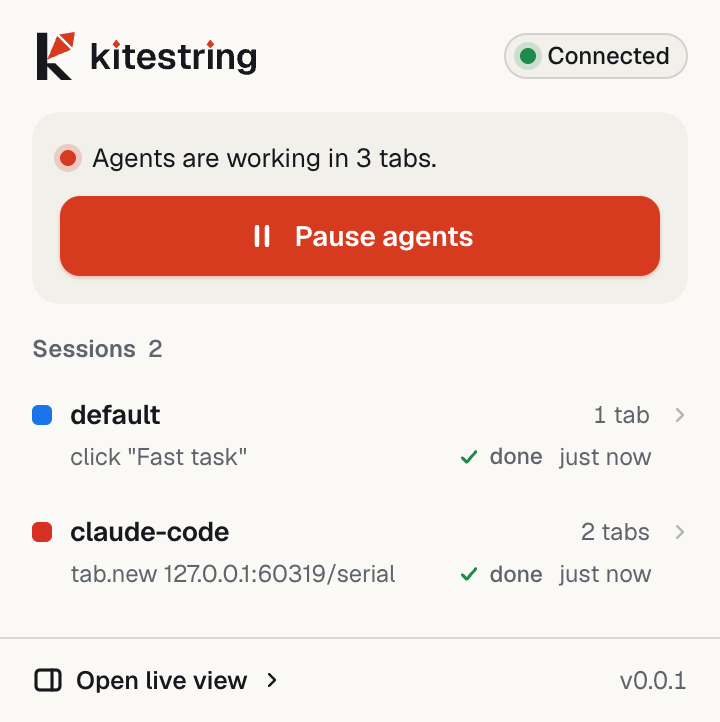
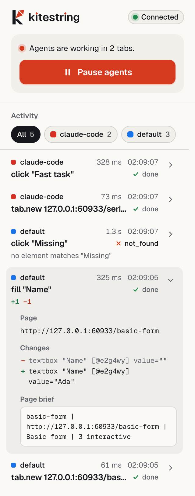
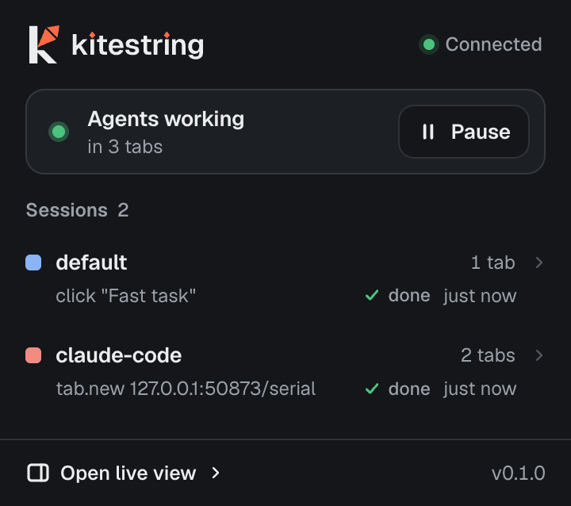
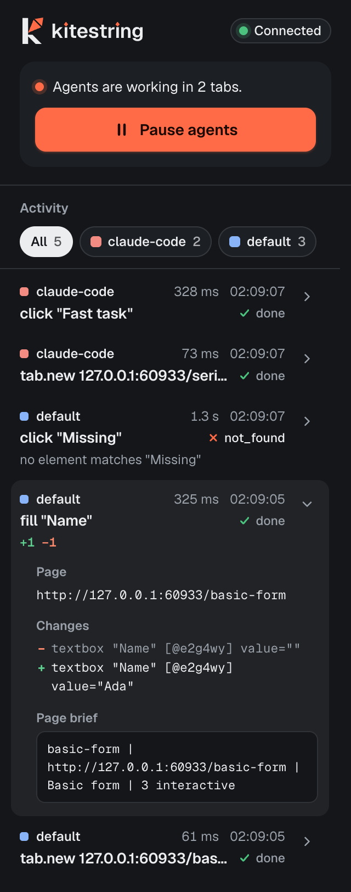
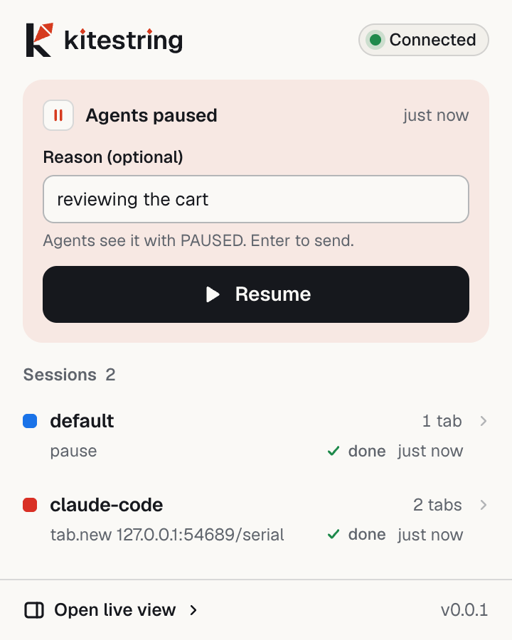

# Kitestring reference

Everything the [README](../README.md) leaves out: every MCP tool, every `kite` command and flag, batches, guards,
uploads, memory, recording, and the build notes. For problems, see [troubleshooting.md](troubleshooting.md).

- [MCP tools](#mcp-tools)
- [The action pipeline](#the-action-pipeline)
- [Skills](#skills)
- [kite commands](#kite-commands)
- [Output and exit codes](#output-and-exit-codes)
- [Environment variables](#environment-variables)
- [Batches](#batches)
- [Guards](#guards)
- [Upload](#upload)
- [Remembered tasks and memory](#remembered-tasks-and-memory)
- [Recording a task](#recording-a-task)
- [The popup and the side panel](#the-popup-and-the-side-panel)
- [Safety model](#safety-model)
- [Native host and extension identity](#native-host-and-extension-identity)
- [Store package](#store-package)
- [Development notes](#development-notes)

## MCP tools

`kite mcp` serves MCP over stdio. The session name comes from `KITE_SESSION` (`kite init` sets one per agent;
the default is `agent`). It exposes 21 tools:

| Tool | What it does |
| --- | --- |
| `browser_status` | whether the extension is connected, and this session's state |
| `browser_tabs`, `browser_tab_new`, `browser_tab_use`, `browser_tab_close` | list, open, select and close this session's tabs |
| `browser_goto` | navigate the active tab |
| `browser_snapshot` | read the page as a compact tree with refs |
| `browser_click`, `browser_fill`, `browser_select`, `browser_press`, `browser_scroll`, `browser_upload` | act on the page; each returns a diff of what changed |
| `browser_batch` | run a list of steps in one call (see [Batches](#batches)) |
| `browser_console`, `browser_network` | recent console messages and network requests of the tab |
| `browser_screenshot` | capture the tab (the viewport, the whole page, or one element by ref) |
| `browser_ask_human` | ask the person at the browser to do something only they should (captcha, 2FA code, password, login); waits up to 40 s per call and answers `waiting`, `done` or `declined` |
| `browser_plan_find`, `browser_plan_run`, `browser_plan_save`, `browser_plan_discard` | find, replay, save and drop remembered tasks: plans built from the agent's batches, with every typed value a parameter |

## The action pipeline

Every action runs the same pipeline, **FIND → CHECK → ACT → WAIT → VERIFY → REPORT**: it finds the target by name,
checks that nothing covers it and that it is not disabled, acts with real input events, waits until the DOM and
network are quiet, then reports what changed.

## Skills

Three skills ship with Kitestring and are installed by `kite init` into `~/.agents/skills` (with symlinks in
`~/.claude/skills`):

- `kitestring`: how to use the tools well.
- `kitestring-debug-frontend`: diagnose a broken UI.
- `kitestring-e2e-verify`: check a change in the browser before calling it done.

The skills tell agents to treat page content as untrusted data, never as instructions, never to type passwords, and
to ask for a fresh yes before a risky click.

## kite commands

Global options: `--session <name>` (or `KITE_SESSION`; default `default`) keeps separate agents' tabs apart, and
`--json` prints the raw result. Each session gets its own tab group, `kite:<name>`.

Targets are visible text or a ref from a snapshot (`@e…`). `click`, `fill`, `select` and `upload` also take
`--within <name>` (look inside a named region) and `--role <role>`.

### Setup

| Command | What it does |
| --- | --- |
| `kite init [--agents <list>] [--dry-run] [--yes]` | register the `kitestring` MCP server with your agents, install the skills and the native host, write `$KITE_HOME/bin/kite` |
| `kite uninstall-agents [--agents <list>] [--dry-run] [--yes]` | remove what `kite init` added (MCP entries, skills, symlinks, `$KITE_HOME/bin/kite`) |
| `kite install-host [--browser chrome\|chromium] [--user-data-dir <dir>] [--extension-id <id>]` | write the native host manifest and wrapper (default browser `chrome`) |
| `kite doctor` | check the install end to end (read-only); prints a fix hint for anything failing |
| `kite mcp` | serve MCP over stdio |
| `kite status` | `{"connected": true, ...}` when the extension is connected |

`--agents` takes a comma-separated subset of `claude-code,codex,cursor,gemini,opencode`. `kite init` never
overwrites your other config, backs each file up once as `<file>.kite-backup-<timestamp>`, skips agents you do not
have, and is safe to re-run. It never edits shell profiles: if `$KITE_HOME/bin` is not on your `PATH`, it prints the
line to add.

### Tabs and pages

| Command | What it does |
| --- | --- |
| `kite tab new [url]` | open a tab in this session and make it active |
| `kite tab list` | this session's tabs |
| `kite tab use <id>` | make a tab of this session the active one |
| `kite tab close [id]` | close a tab (the active one without an id) |
| `kite goto <url>` | navigate the active tab |
| `kite snapshot [--full] [--scope <ref>]` | the visible page as a compact tree with refs; `--full` for everything, `--scope` to limit it to one ref |
| `kite screenshot [--full] [--ref <ref>] [-o <file>]` | PNG of the active tab; prints the file path (default `$KITE_HOME/shots/<timestamp>.png`) |
| `kite console [--errors] [--limit <n>] [--clear]` | console messages and uncaught errors (newest 50 by default) |
| `kite network [--failed] [--filter <s>] [--limit <n>] [--clear]` | network requests; `--failed` keeps status ≥ 400 and requests with no response |

### Actions

| Command | What it does |
| --- | --- |
| `kite click <target>` | click |
| `kite fill <target> <text>` | type into a field |
| `kite select <target> <value>` | choose an option |
| `kite press <key>` | press a key (`Enter`, `Escape`, `Tab`, …) |
| `kite scroll <up\|down> [px]` | scroll one viewport, or `px` pixels |
| `kite upload <target> <files...>` | put files into a file input, a button that opens one, or a drop zone (see [Upload](#upload)) |
| `kite batch <file\|->` `[--budget <ms>] [--allow-domain <domain>]...` | run steps from a JSON file or stdin (see [Batches](#batches)) |

Examples:

```sh
kite tab new https://example.com && kite snapshot
kite click "Learn more"            # or by ref: kite click @e1a2b3
kite fill Email ada@example.com
kite select Country India
kite press Enter
kite scroll down                   # one viewport; or: kite scroll up 400
kite goto https://example.org
```

### Control

| Command | What it does |
| --- | --- |
| `kite pause [reason]` | stop all agents from acting until resumed; the reason reaches the agents |
| `kite resume` | let agents act again |
| `kite ask <reason> [--timeout <s>]` | ask the person at the browser to do something (captcha, 2FA, login) and wait for Done or Can't do it; exit 0 done, 1 declined, 2 still waiting at the timeout (600 s by default) |
| `kite activity [--limit <n>]` | recent agent actions, newest first (200 by default) |

### Memory, replay and recording

| Command | What it does |
| --- | --- |
| `kite memory save <intent>` | save this session's batches since the last save as a plan for `<intent>` |
| `kite memory list` | saved plans, with their parameters (secret ones starred) |
| `kite memory find <intent> [--site <url>]` | the saved plan that best matches `<intent>` (exit 1 when none) |
| `kite memory show <slug>` | a plan as JSON |
| `kite memory forget <slug>` | delete a plan |
| `kite memory discard` | drop this session's unsaved journal |
| `kite run <plan> [--param name=value]... [--secret name=value]... [--dry-run]` | replay a plan (`<site>/<slug>`, or a bare slug when unique) |
| `kite schedule add <plan> --every <30m\|6h\|1d\|1w> [--param name=value]... [--name <slug>]` | replay a plan on its own every so often while Chrome runs; the first run is as soon as you are away (plans with secret params are refused) |
| `kite schedule list` | schedules, their next run and how the last one went |
| `kite schedule run <name>` | run a schedule now (its timer is unchanged) |
| `kite schedule remove <name>` | delete a schedule (the plan stays) |
| `kite record start --name <slug>` | record what you do by hand in this session's active tab |
| `kite record stop [--force]` | stop and write the skill and its plan |
| `kite cache stats` | entries, sites, hits |
| `kite cache clear [--site <origin>]` | clear the action cache, or one origin's entries |

## Output and exit codes

A successful action prints `✓ done` followed by the diff. When an action fails, it says why and exits 1:

- `✗ blocked: covered by dialog "Cookie banner"`
- `✗ disabled: Enter a valid email`
- `✗ ambiguous` (followed by the candidate refs)
- `✗ not_found`
- `✗ no_effect`
- `✗ timeout`

| Exit | Meaning |
| --- | --- |
| 0 | done |
| 1 | the action or batch did not finish (`status` other than `done`, a halted batch), or an error from the browser |
| 2 | the browser is not connected (`NOT_CONNECTED`), the usage was wrong, or `kite run` is missing a parameter |
| 3 | `kite run` stopped at a risky step |

If the browser does not answer at all, the CLI gives up after 60 s (`kite: timed out waiting for the browser`, exit
1). `--json` prints the raw result, errors too, as `{"error":{"code","message"}}`. Pages the browser does not let
extensions touch answer `restricted page (…) — browser blocks extensions here`.

## Environment variables

| Variable | Effect |
| --- | --- |
| `KITE_HOME` | where Kitestring keeps its socket, logs, memory, screenshots and the `kite` command (default `~/.kitestring`) |
| `KITE_SESSION` | the session name (the CLI default is `default`; `kite mcp` defaults to `agent`) |
| `KITE_TIMEOUT_MS` | how long the CLI waits for the browser (default 60000) |
| `KITE_BATCH_BUDGET_MS` | the MCP server's batch time budget (`kite init` sets 12000 for OpenCode) |
| `KITE_UPLOAD_ALLOW` | colon-separated directories that override the upload location rules |
| `KITE_UPDATE_DOCS` | `1` makes the e2e suite refresh the README and store images |

## Batches

`kite batch <file|->` (or the `browser_batch` tool) runs up to 50 steps in one call, under one tab lock, and returns
one result with one diff. A form that took ten round trips takes one:

```sh
kite batch - <<'JSON'
[
  {"action": "fill", "target": "Name", "value": "Ada"},
  {"action": "fill", "target": "Email", "value": "ada@x.io"},
  {"action": "click", "target": "Submit", "expect": {"text": "Thanks"}}
]
JSON
```

Steps are `goto`, `click`, `fill`, `select`, `press`, `scroll`, `upload` (`files`), `switch_tab` (`to`: `"new"`,
`"opener"` or a tab id) and `wait` (`ms`). A step can also carry `wait`, `expect` (`{text}` or `{url}`),
`if_present`, `within`, `role` and `dialog`. A target on a page that is not there yet (a tab's hidden fields, the
next page of a flow) is found when its step runs. The file may also be an object,
`{"steps": [...], "allow_domains": [...], "budget_ms": 12000}`.

A batch stops at the first step that does not work and says where: `halted: {index, reason, detail}`, plus `next`,
the step to resend from. Reasons: `not_found`, `ambiguous`, `blocked`, `disabled`, `error`, `timeout`, `restricted`,
`domain`, `dialog`, `expect`, `risky`, `paused`, `time`. The time budget is 40 s by default (`--budget <ms>`,
clamped to 5 to 40 s; the MCP server reads `KITE_BATCH_BUDGET_MS`). Each step shows in the activity list, grouped as
one batch.

## Guards

A batch (and a single action) is guarded against the things that derail agents:

- **Risky clicks halt a batch.** A click on a button named like `pay`, `buy`, `purchase`, `place order`, `send`,
  `delete`, `remove account`, `publish`, `submit for review`, `transfer` or `confirm payment` halts the batch with
  `risky` before anything is clicked. A `press Enter` or `press Space` on a focused button or link is checked
  against that control's name, and an Enter in a form field against the form's submit button (or, without one, the
  form's name or `action`); either halts the same way. An Enter in a textarea or rich-text field adds a line and is
  not checked. Run that one click on its own (`kite click "Place order"`); a single click is never blocked.
- **Dialogs.** `alert` is accepted and reported. `confirm` and `prompt` are dismissed; in a batch that also halts
  `dialog`, unless the step has a `dialog` policy (`"accept"` or `"dismiss"`).
- **Cookie walls and newsletter modals.** When one covers the target, kite closes it once (it prefers "Reject all"
  or "Necessary only", then "Accept"; newsletter modals get "Close" or "No thanks", never "Subscribe") and goes on.
  The result says what it closed.
- **New tabs and popups.** Tabs opened by the page (`target=_blank`, OAuth popups) join your session and are listed
  as `newTabs`; `switch_tab` follows them. A step that closes its own tab (an OAuth "Allow") carries on in the
  opener.
- **Domain guard.** After each step, the site of the active tab must be the batch's start site, one of
  `allow_domains` (or `--allow-domain`), or one a `goto` or `expect.url` of the batch names. Otherwise the batch
  halts `domain`.

## Upload

`kite upload <target> <file...>` (or `browser_upload`, or an `upload` step) puts local files into a file input, a
button that opens one, or a drop zone. Paths are resolved to their real location first (relative paths against your
working directory), and the CLI refuses, before the browser is touched:

- anything under `~/.ssh`, `~/.aws`, `~/.gnupg`, `~/.kitestring` (`$KITE_HOME`), `~/.config` (so also
  `~/.config/gcloud`), `~/.docker`, `~/.kube`, `~/.azure`, `~/Library/Keychains`, or the Chrome / Chromium profile
  folders in `~/Library/Application Support`;
- the credential and history files `~/.netrc`, `~/.git-credentials`, `~/.npmrc`, `~/.pypirc`, `~/.bash_history`,
  `~/.zsh_history` and `~/.local/share/fish/fish_history`;
- a file named `.env*`;
- a file over 100 MB, or anything that is not a regular file.

The error is `BAD_REQUEST: refusing to upload <path>: <reason>`. To allow a location anyway, set `KITE_UPLOAD_ALLOW`
to a colon-separated list of directories; it overrides the location rules only, never the size and type rules. The
activity log records base names, never paths.

## Remembered tasks and memory

Remembered tasks and recorded skills make a repeated task cheaper than the first run: a replay is one tool call
instead of an agent turn per page. None of it calls a model, and all of it stays on your computer.

### Remembered tasks

When your agent runs a batch that works, `kite` journals its steps with every typed value already replaced by a
named parameter (`{{email}}`); no value is ever written down. Ask the agent to save a task, or do it yourself:

```sh
kite memory save "fill the shipping form"   # turn this session's journal into a plan
kite memory list
kite memory show <slug>
kite run <site>/<slug> --param email=ada@x.io --secret password=...   # replay (a bare slug works when unique)
kite run <slug> --dry-run                                       # print the filled batches, send nothing
```

`kite run` checks that every parameter is given (exit 2, before the browser is touched), runs the plan with
`act.batch` and stops at the first step that no longer works, saying which and why, and leaves the page where it
stopped so the agent can take over. A risky click is never auto-continued (exit 3). Over MCP the same flow is
`browser_plan_find` (is there a plan for this task?), `browser_plan_run` (replay it by the `id` find returned;
`secrets` names the params whose values are never kept, like `--secret`) and `browser_plan_save` (remember what just
worked), and `browser_plan_discard` drops the unsaved journal.

### Memory

Plans live in `$KITE_HOME/memory/<site>/<plan>.json` (directories 0700, files 0600) and hold the intent, the site, a
path pattern, parameter names and the batches. A plan is found by site first, then by how much its intent overlaps
the task. `kite memory forget <slug>` removes one; `kite memory discard` drops the unsaved journal.

### Schedules

A schedule replays a saved plan every 5 minutes or more, with no agent and no model calls. The native host runs it,
so it only happens while Chrome (and the extension) runs: a run missed while Chrome was closed happens once at the
next start, then the timer goes on from there. A due run waits until you have been away for a minute (no mouse or
keyboard input; a locked screen does not count), or until it is an hour late, then opens the plan's page in a new
window in front, in its own session (`schedule-<name>`). It has to be visible: Chrome stops drawing background tabs and
covered windows, and clicks and scrolls sent to them never finish. Each run ends with a notification. A full run closes its
window; a stop (a target gone, a risky click, a guard) leaves it where it stopped, and a click on the notification
shows it. While Kitestring is paused, runs are skipped without a notification. Schedules live in
`$KITE_HOME/schedules.json` (owner-only) with their param values; a plan with secret params cannot be scheduled.

### Action cache

The extension remembers where it found each element (by site, page shape and the text you asked for). The next find
for the same text still runs the full search; when the element it picks is the one remembered, the step says
`cached: true`, and otherwise the entry is updated. The hint never chooses an element on its own, so **the cache
does not save time today**. It never keeps password, card or one-time-code fields, picked options (list, menu, tree
and grid choices), or targets filled from a plan's parameters.

```sh
kite cache stats                       # entries, sites, hits
kite cache clear                       # everything
kite cache clear --site https://example.com
```

## Recording a task

`kite record start --name <slug>` begins recording what you do by hand in the kite session's active tab, so open the
page with `kite tab new <url>` first (with no session tab it fails with `NO_TAB`). `kite record stop` writes it as a
skill your agents pick up: `~/.agents/skills/kite-<name>/SKILL.md` (with a symlink in `~/.claude/skills`), plus the
plan in memory.

- Typed values become parameters and are never stored.
- Password and one-time-code fields are recorded as steps with a secret parameter; only their values are never
  kept, not even as a hash.
- A file input becomes a step whose file is a parameter; the file's name is never stored.
- While you record, agents can neither act in that tab nor read it (snapshots, console, network, screenshots).
- It refuses to overwrite an existing skill unless you pass `--force` (the old one is backed up first).
- If writing the skill fails, the recording stays in the browser, so you can fix the cause and run
  `kite record stop` again.

## The popup and the side panel

The popup shows the connection, the Pause switch, each agent session and its last action. The side panel is a live
view of what agents are doing: every action, grouped by batch, with its diff.

| Popup | Side panel |
| --- | --- |
|  |  |
|  |  |

Paused:



When an agent asks for the person (`browser_ask_human`, `kite ask`), Chrome shows a notification with **Done** and
**Can’t do it**, the toolbar icon gets a `!` badge, the agent's tab comes to the front, and the popup and the side
panel show a card with the same two answers. One request stays open per session; an answer given while the agent is
not waiting is kept for its next call with the same reason. Turning off Chrome's notifications leaves the badge and the
card.

## Safety model

- **Pause switch.** Pause from the popup, the side panel, or `kite pause` (`kite resume` to continue). An action
  already in flight finishes or hits its time cap; queued and new requests are refused immediately with `PAUSED`.
- **Per-session ownership.** Each agent session gets its own tab group, `kite:<session>`, and can only act on tabs it
  owns. Touching another session's tab fails with `NOT_OWNER`.
- **Restricted pages are refused.** `chrome://` pages, the Chrome Web Store and other pages the browser keeps from
  extensions answer `restricted page`.
- **One action at a time per tab.** If two agents target the same tab, the second waits rather than interleaving
  input.
- **Page text is data.** The skills tell agents to treat page content as untrusted data, never as instructions, and
  never to type passwords.
- **Debugging bar.** While kite acts on a tab, Chrome shows its "started debugging this browser" bar. That is
  expected; if you cancel it, the next action attaches again.

Batches also halt on risky clicks and dialogs, and uploads have a deny list (see [Guards](#guards) and
[Upload](#upload)).

## Native host and extension identity

```sh
kite install-host                 # Chrome; use --browser chromium for Chromium
```

This writes `com.kitestring.bridge.json` into the browser's `NativeMessagingHosts` directory and a wrapper script
into `$KITE_HOME` (default `~/.kitestring`). `--user-data-dir <dir>` targets a custom profile directory, and
`--extension-id <id>` allows an extension ID other than the default. Reload the extension (or restart Chrome)
afterwards so it connects to the host, then check with `kite status`.

The extension ID is fixed by the public key in `packages/extension/package.json` (`manifest.key`):
`bdfegcbeenjmlbfogodoibdhfbonnicm`. That is the ID the native host allows by default (`EXTENSION_ID` in
`packages/protocol/src/constants.ts`). You do **not** need the private key to load the extension unpacked. To use
your own key pair instead:

```sh
node scripts/gen-extension-key.mjs   # writes keys/bx.pem (gitignored), prints {key, id}
```

Then put `key` into `manifest.key` in `packages/extension/package.json` and `id` into `EXTENSION_ID`, and rebuild.
Without `--force`, the script reuses an existing `keys/bx.pem`.

Until `kite init` has written `$KITE_HOME/bin/kite`, `node packages/cli/dist/bin.js <command>` works the same.

## Store package

```sh
pnpm package:store
```

Needs `zip` and `unzip` on your PATH (macOS and Linux). Builds the production extension, after deleting the old
build folder, and writes `dist/kitestring-<version>.zip` (and prints its path and size). The script removes
`manifest.key` (the Web Store assigns its own id), and fails if the build holds a `.map` file, a dotfile, `.env*`,
`*.pem`, `*.key`, `key.json`, a `keys/` folder or a symlink. The listing text, the permission justifications and the
privacy policy are in `store/` (`listing.md`, `privacy.md`); the screenshots in `store/screenshots/` are regenerated
with `KITE_UPDATE_DOCS=1` (`e2e/store-shots.spec.ts`) and `docs/demo.gif` with `e2e/demo.spec.ts`. Nothing is
uploaded for you: you submit the zip in the Developer Dashboard yourself.

Once the Store gives the extension its id, put it in `KITE_STORE_EXTENSION_ID`
(`packages/protocol/src/constants.ts`). The native host then allows both that id and the developer id
(`kite install-host`, `kite init`, and `kite doctor` agree on the list).

## Development notes

### Prerequisites

- **macOS or Linux** (Windows is untested; see [troubleshooting.md](troubleshooting.md#windows)).
- **Node ≥ 22.12** (commander 15 needs it). Node 26 works too; `.nvmrc` says 22.12.
- **pnpm.** Install it with `npm i -g pnpm`; corepack no longer ships with Node ≥ 25. This repo pins pnpm 12.14.0
  (`packageManager` in `package.json`).
- **Google Chrome or Chromium.**

### Tests

```sh
pnpm test        # unit tests: protocol, CLI/host, torture server, page agent (Vitest + Playwright), store packaging
pnpm -r typecheck
pnpm test:e2e    # page-agent fixtures + full end-to-end against the torture site
```

The end-to-end suite (`e2e/`):

- needs `pnpm build` first;
- runs headless and doesn't touch your Chrome profile or `~/.kitestring`;
- for each test, installs the native host into a temporary user-data-dir and starts the torture site
  (`apps/torture`, edge-case and multi-page flow pages; see `apps/torture/expected.md`);
- launches **Playwright's Chromium** with the built extension, then drives everything through the real `kite` CLI;
- with `KITE_UPDATE_DOCS=1`, refreshes `docs/ui/` (the popup and side panel), `docs/demo.gif`, `docs/screenshots/`
  and `store/screenshots/`. The demo and store images are composed by `e2e/scene.ts` from real captures of
  `apps/torture/pages/showcase-listing.html`, the side panel and the popup.

If Playwright's Chromium is missing, install it with
`pnpm --filter @kitestring/e2e exec playwright install chromium`. To serve the torture site by hand, run
`pnpm --filter torture dev` (http://127.0.0.1:4173).

### Benchmark

`pnpm bench` runs the scripted time-to-done benchmark (`apps/bench`); `pnpm build && pnpm bench --write` updates
[bench.md](bench.md).

### Environment notes

- **Node 26** builds and runs everything, Plasmo included.
- **pnpm 12** ignores the `pnpm.onlyBuiltDependencies` field in `package.json`. Packages that need install scripts
  (esbuild, @swc/core, @parcel/watcher, lmdb, msgpackr-extract, sharp) are allowed through `allowBuilds:` in
  `pnpm-workspace.yaml`.
- **zod is pinned to `~3.24.4`** in `@kitestring/protocol`. Plasmo's Parcel bundles zod 3.25 incorrectly (`z` is
  undefined), which crashes the service worker at startup.
- **e2e uses Playwright's Chromium (`channel: "chromium"`), not branded Chrome.** Branded Chrome ≥ 137 ignores
  `--load-extension`. With a custom `--user-data-dir`, Chromium reads native host manifests from
  `<user-data-dir>/NativeMessagingHosts`, so tests write nothing outside temp dirs.
