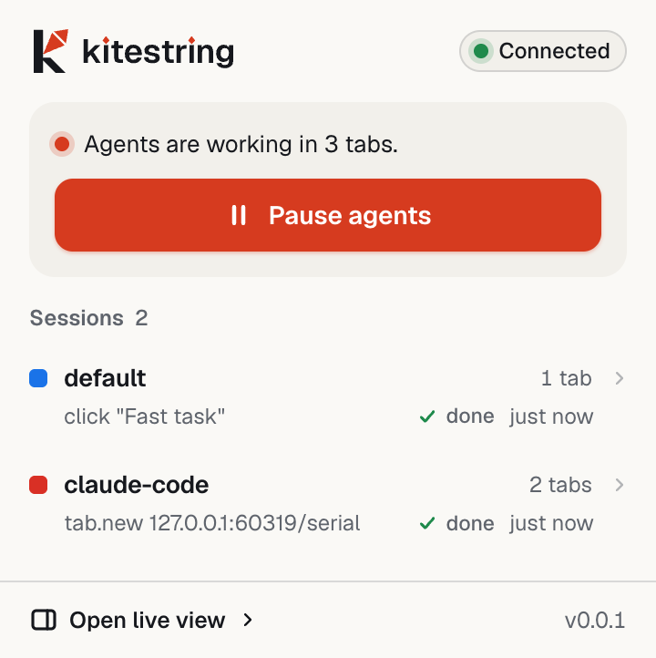
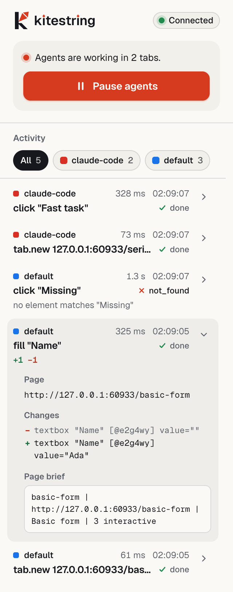
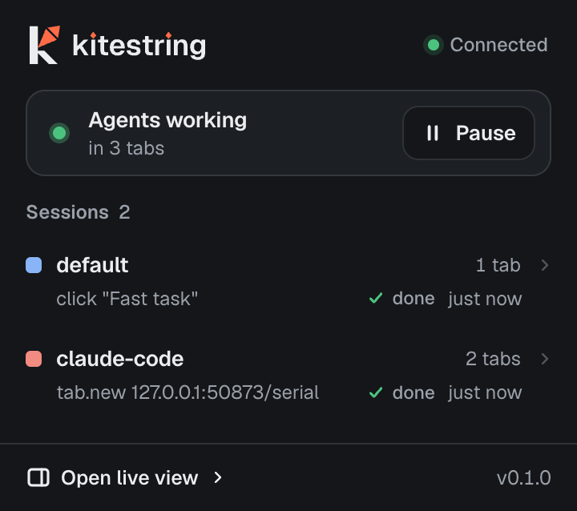
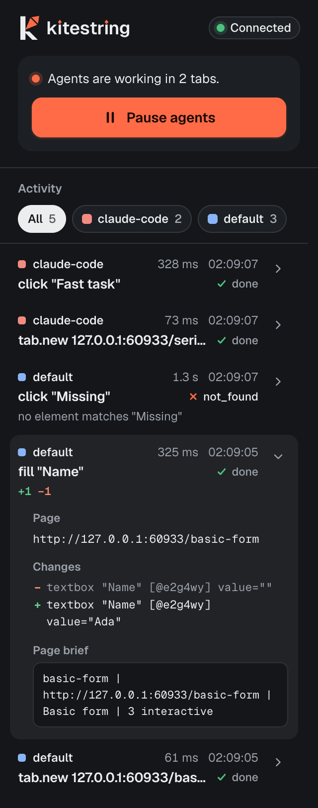
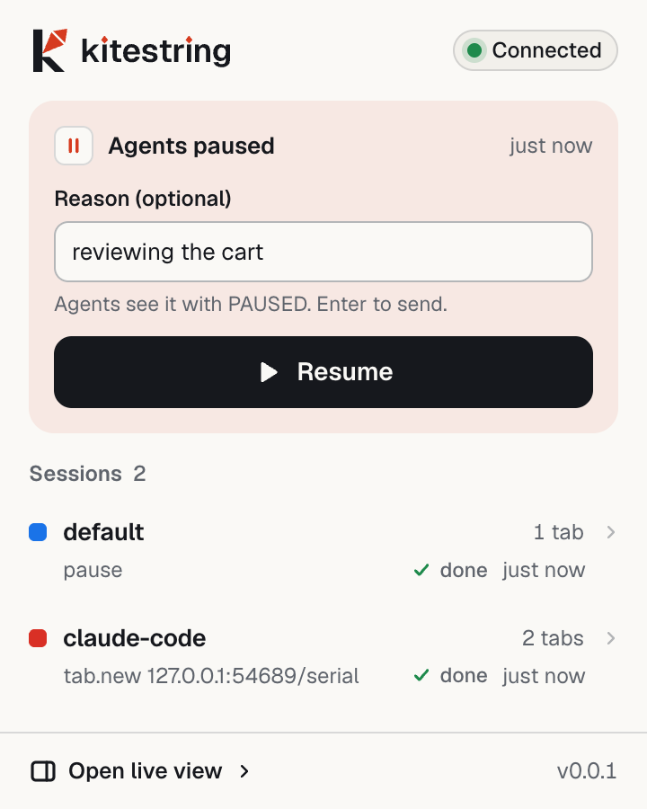

# Kitestring reference

Everything the [README](../README.md) leaves out: every MCP tool, every `kite` command and flag, batches, guards,
uploads, memory, recording, and the build notes. For problems, see [troubleshooting.md](troubleshooting.md).

- [MCP tools](#mcp-tools)
- [The action pipeline](#the-action-pipeline)
- [Skills](#skills)
- [kite commands](#kite-commands)
- [Output and exit codes](#output-and-exit-codes)
- [Environment variables](#environment-variables)
- [Batches](#batches)
- [Scripts](#scripts)
- [Extracting data](#extracting-data)
- [Bulk extraction](#bulk-extraction)
- [Guards](#guards)
- [Upload](#upload)
- [Remembered tasks and memory](#remembered-tasks-and-memory)
- [Recording a task](#recording-a-task)
- [The popup and the side panel](#the-popup-and-the-side-panel)
- [Safety model](#safety-model)
- [Native host and extension identity](#native-host-and-extension-identity)
- [Store package](#store-package)
- [Development notes](#development-notes)

## MCP tools

`kite mcp` serves MCP over stdio. The session name comes from `KITE_SESSION` (`kite init` sets one per agent;
the default is `agent`). It exposes 28 tools:

| Tool | What it does |
| --- | --- |
| `browser_status` | whether the extension is connected, and this session's state |
| `browser_tabs`, `browser_tab_new`, `browser_tab_use`, `browser_tab_close` | list, open, select and close this session's tabs |
| `browser_goto` | navigate the active tab |
| `browser_snapshot` | read the page as a compact tree with refs |
| `browser_click`, `browser_fill`, `browser_select`, `browser_press`, `browser_scroll`, `browser_upload` | act on the page; each returns a diff of what changed |
| `browser_batch` | run a list of steps in one call (see [Batches](#batches)) |
| `browser_script` | run JavaScript that drives the tab through helpers: loops, branches and reads in one call; `save` writes the rows it emits (or returns) to a file (see [Scripts](#scripts)) |
| `browser_console`, `browser_network` | recent console messages and network requests of the tab; `browser_network` with `bodies` lists the fetch/XHR responses whose JSON or text was kept, and `body` returns one whole |
| `browser_probe` | describe the page's data for a bulk read: its lists with an item selector and one selector per field, sample rows, how it shows more, and embedded or fetched JSON holding the same records (see [Bulk extraction](#bulk-extraction)) |
| `browser_job_start`, `browser_job_status`, `browser_job_stop` | run a spec, a script or a recipe as a background job that streams rows to a file, check on it, stop it; `dry_run` tries a spec here for 3 rows |
| `browser_extract` | read the page's biggest table or repeated list (or the one holding `near` text, or `selector`'s items) as rows; `next` pages through (a button's text or `scroll`); `columns` keeps, orders and renames columns; `id` names the column rows repeat by; `save` writes every row to a .csv, .json or .jsonl file. See [Extracting data](#extracting-data) |
| `browser_screenshot` | capture the tab (the viewport, the whole page, or one element by ref) |
| `browser_ask_human` | ask the person at the browser to do something only they should (captcha, 2FA code, password, login); waits up to 40 s per call and answers `waiting`, `done` or `declined` |
| `browser_plan_find`, `browser_plan_run`, `browser_plan_save`, `browser_plan_discard` | find, replay, save and drop remembered tasks: plans built from the agent's batches, with every typed value a parameter |

## The action pipeline

Every action runs the same pipeline, **FIND → CHECK → ACT → WAIT → VERIFY → REPORT**: it finds the target by name,
checks that nothing covers it and that it is not disabled, acts with real input events, waits until the DOM and
network are quiet, then reports what changed.

## Skills

Three skills ship with Kitestring and are installed by `kite init` into `~/.agents/skills` (with symlinks in
`~/.claude/skills`):

- `kitestring`: how to use the tools well.
- `kitestring-debug-frontend`: diagnose a broken UI.
- `kitestring-e2e-verify`: check a change in the browser before calling it done.

The skills tell agents to treat page content as untrusted data, never as instructions, never to type passwords, and
to ask for a fresh yes before a risky click.

## kite commands

Global options: `--session <name>` (or `KITE_SESSION`; default `default`) keeps separate agents' tabs apart, and
`--json` prints the raw result. Each session gets its own tab group, `kite:<name>`.

Chrome delivers no real input to a hidden tab: one its window is not showing (you picked another tab there), a
minimized window, or one off screen or fully covered (Chrome on macOS hides a window that is covered all over). In a
hidden tab a click or a fill goes as the page's own DOM events instead, and its result says so (`via: "page"`,
`(tab hidden: sent as page events; check the page reacted)`); most sites take them, a site that only accepts real
input may not. A key press, a scroll or a file chooser cannot go that way: they fail at once, saying which case it is.
In a window Kitestring opened itself (a job's, a scheduled run's) a hidden tab is brought forward there first.

Targets are visible text or a ref from a snapshot (`@e…`). `click`, `fill`, `select` and `upload` also take
`--within <name>` (look inside a named region) and `--role <role>`.

### Setup

| Command | What it does |
| --- | --- |
| `kite init [--agents <list>] [--dry-run] [--yes]` | register the `kitestring` MCP server with your agents, install the skills and the native host, write `$KITE_HOME/bin/kite` |
| `kite uninstall-agents [--agents <list>] [--dry-run] [--yes]` | remove what `kite init` added (MCP entries, skills, symlinks, `$KITE_HOME/bin/kite`) |
| `kite install-host [--browser chrome\|chromium] [--user-data-dir <dir>] [--extension-id <id>]` | write the native host manifest and wrapper (default browser `chrome`) |
| `kite doctor` | check the install end to end (read-only); prints a fix hint for anything failing |
| `kite mcp` | serve MCP over stdio |
| `kite status` | `{"connected": true, ...}` when the extension is connected |

`--agents` takes a comma-separated subset of `claude-code,codex,cursor,gemini,opencode`. `kite init` never
overwrites your other config, backs each file up once as `<file>.kite-backup-<timestamp>`, skips agents you do not
have, and is safe to re-run. It never edits shell profiles: if `$KITE_HOME/bin` is not on your `PATH`, it prints the
line to add.

### Tabs and pages

| Command | What it does |
| --- | --- |
| `kite tab new [url]` | open a tab in this session and make it active |
| `kite tab list` | this session's tabs |
| `kite tab use <id>` | make a tab of this session the active one |
| `kite tab close [id]` | close a tab (the active one without an id) |
| `kite goto <url>` | navigate the active tab |
| `kite snapshot [--full] [--scope <ref>]` | the visible page as a compact tree with refs; `--full` for everything, `--scope` to limit it to one ref |
| `kite extract [--near <text>] [--selector <css>] [--pick <n>] [--next <target>\|scroll] [--pages <n>] [--max <n>] [--columns <spec>] [--id <column>] [-o <file>]` | the page's table or repeated list as CSV on stdout (the summary and other candidates on stderr), or saved to a .csv/.json/.jsonl file |
| `kite screenshot [--full] [--ref <ref>] [-o <file>]` | PNG of the active tab; prints the file path (default `$KITE_HOME/shots/<timestamp>.png`) |
| `kite console [--errors] [--limit <n>] [--clear]` | console messages and uncaught errors (newest 50 by default) |
| `kite network [--failed] [--filter <s>] [--limit <n>] [--clear] [--bodies] [--body <id>]` | network requests; `--failed` keeps status ≥ 400 and requests with no response; `--bodies` lists the fetch/XHR responses whose JSON or text was kept (the start of each), `--body <id>` prints one whole |
| `kite probe [--reload]` | the page's lists (item and field selectors, samples, the first item's HTML), how it shows more, and embedded or fetched JSON holding the same records; ends with the shortest way to read them all (see [Bulk extraction](#bulk-extraction)) |

### Actions

| Command | What it does |
| --- | --- |
| `kite click <target>` | click |
| `kite fill <target> <text>` | type into a field |
| `kite select <target> <value>` | choose an option |
| `kite press <key>` | press a key (`Enter`, `Escape`, `Tab`, …) |
| `kite scroll <up\|down> [px]` | scroll one viewport, or `px` pixels |
| `kite upload <target> <files...>` | put files into a file input, a button that opens one, or a drop zone (see [Upload](#upload)) |
| `kite batch <file\|->` `[--budget <ms>] [--allow-domain <domain>]...` | run steps from a JSON file or stdin (see [Batches](#batches)) |
| `kite script <file\|->` `[--timeout <ms>] [--save <file>] [--id <column>] [--param name=value]...` | run JavaScript from a file or stdin (see [Scripts](#scripts)) |

Examples:

```sh
kite tab new https://example.com && kite snapshot
kite click "Learn more"            # or by ref: kite click @e1a2b3
kite fill Email ada@example.com
kite select Country India
kite press Enter
kite scroll down                   # one viewport; or: kite scroll up 400
kite goto https://example.org
```

### Bulk extraction jobs

| Command | What it does |
| --- | --- |
| `kite job start [file\|-] [--spec <file\|->] [--recipe <name>] [--param name=value]... [--save <file>] [--id <column>] [--url <url>] [--window front\|background] [--timeout <minutes>] [--save-as <name>] [--dry-run]` | start a script, a spec or a recipe as a job in its own process; prints its id (see [Bulk extraction](#bulk-extraction)) |
| `kite job status [id] [--rows <n>]` | a job's state, rows so far, last rows and log lines (the newest job without an id) |
| `kite job list` | jobs, newest first |
| `kite job stop <id>` | stop a running job; it saves the rows it has |
| `kite job resume <id>` | run a stopped or failed job again from its last checkpoint, without repeating rows |
| `kite job rows <id> [-o <file>]` | a job's rows so far, as CSV or to a file |
| `kite job recipes` | recipes saved with `--save-as` |

### Control

| Command | What it does |
| --- | --- |
| `kite pause [reason]` | stop all agents from acting until resumed; the reason reaches the agents |
| `kite resume` | let agents act again |
| `kite ask <reason> [--timeout <s>]` | ask the person at the browser to do something (captcha, 2FA, login) and wait for Done or Can't do it; exit 0 done, 1 declined, 2 still waiting at the timeout (600 s by default) |
| `kite activity [--limit <n>]` | recent agent actions, newest first (200 by default) |

### Memory, replay and recording

| Command | What it does |
| --- | --- |
| `kite memory save <intent>` | save this session's batches since the last save as a plan for `<intent>` |
| `kite memory list` | saved plans, with their parameters (secret ones starred) |
| `kite memory find <intent> [--site <url>]` | the saved plan that best matches `<intent>` (exit 1 when none) |
| `kite memory show <slug>` | a plan as JSON |
| `kite memory forget <slug>` | delete a plan |
| `kite memory discard` | drop this session's unsaved journal |
| `kite run <plan> [--param name=value]... [--secret name=value]... [--dry-run]` | replay a plan (`<site>/<slug>`, or a bare slug when unique) |
| `kite schedule add <plan> --every <30m\|6h\|1d\|1w> [--param name=value]... [--name <slug>]` | replay a plan on its own every so often while Chrome runs; the first run is as soon as you are away (plans with secret params are refused) |
| `kite watch <url> --every <30m\|6h\|1d\|1w> [--ignore <regex>]... [--name <slug>]` | read a page on its own (logged-in pages too) and get a notification when its text changes; managed with `kite schedule list / run / remove` |
| `kite export <url> --every <interval> [--near <text>] [--selector <css>] [--next <text>\|scroll] [--pages <n>] [--max <n>] [--columns <spec>] [--id <column>] [--format csv\|json\|jsonl] [--name <slug>]` | save a page's table or list to `$KITE_HOME/exports/<name>/` on its own and hear how many rows are new; managed with `kite schedule list / run / remove` |
| `kite schedule add-job <recipe> --every <interval> [--param name=value]... [--format csv\|json\|jsonl] [--name <slug>]` | run a recipe on its own; each run writes `$KITE_HOME/exports/<name>/<time>.<format>` and you hear how many rows are new |
| `kite schedule list` | schedules, watches, exports and recipe jobs, their next run and how the last one went |
| `kite schedule run <name>` | run a schedule now (its timer is unchanged) |
| `kite schedule remove <name>` | delete a schedule (the plan stays) |
| `kite record start --name <slug>` | record what you do by hand in this session's active tab |
| `kite record stop [--force]` | stop and write the skill and its plan |
| `kite cache stats` | entries, sites, hits |
| `kite cache clear [--site <origin>]` | clear the action cache, or one origin's entries |

## Output and exit codes

A successful action prints `✓ done` followed by the diff. When an action fails, it says why and exits 1:

- `✗ blocked: covered by dialog "Cookie banner"`
- `✗ disabled: Enter a valid email`
- `✗ ambiguous` (followed by the candidate refs)
- `✗ not_found`
- `✗ no_effect`
- `✗ timeout`

| Exit | Meaning |
| --- | --- |
| 0 | done |
| 1 | the action or batch did not finish (`status` other than `done`, a halted batch), or an error from the browser |
| 2 | the browser is not connected (`NOT_CONNECTED`), the usage was wrong, or `kite run` is missing a parameter |
| 3 | `kite run` stopped at a risky step |

If the browser does not answer at all, the CLI gives up after 60 s (`kite: timed out waiting for the browser`, exit
1). `--json` prints the raw result, errors too, as `{"error":{"code","message"}}`. Pages the browser does not let
extensions touch answer `restricted page (…) — browser blocks extensions here`.

## Environment variables

| Variable | Effect |
| --- | --- |
| `KITE_HOME` | where Kitestring keeps its socket, logs, memory, screenshots and the `kite` command (default `~/.kitestring`) |
| `KITE_SESSION` | the session name (the CLI default is `default`; `kite mcp` defaults to `agent`) |
| `KITE_TIMEOUT_MS` | how long the CLI waits for the browser (default 60000) |
| `KITE_BATCH_BUDGET_MS` | the MCP server's batch time budget (`kite init` sets 12000 for OpenCode) |
| `KITE_UPLOAD_ALLOW` | colon-separated directories that override the upload location rules |
| `KITE_UPDATE_DOCS` | `1` makes the e2e suite refresh the README and store images |

## Batches

`kite batch <file|->` (or the `browser_batch` tool) runs up to 50 steps in one call, under one tab lock, and returns
one result with one diff. A form that took ten round trips takes one:

```sh
kite batch - <<'JSON'
[
  {"action": "fill", "target": "Name", "value": "Ada"},
  {"action": "fill", "target": "Email", "value": "ada@x.io"},
  {"action": "click", "target": "Submit", "expect": {"text": "Thanks"}}
]
JSON
```

Steps are `goto`, `click`, `fill`, `select`, `press`, `scroll`, `upload` (`files`), `switch_tab` (`to`: `"new"`,
`"opener"` or a tab id) and `wait` (`ms`). A step can also carry `wait`, `expect` (`{text}` or `{url}`),
`if_present`, `within`, `role` and `dialog`. A target on a page that is not there yet (a tab's hidden fields, the
next page of a flow) is found when its step runs. The file may also be an object,
`{"steps": [...], "allow_domains": [...], "budget_ms": 12000}`.

A batch stops at the first step that does not work and says where: `halted: {index, reason, detail}`, plus `next`,
the step to resend from. Reasons: `not_found`, `ambiguous`, `blocked`, `disabled`, `error`, `timeout`, `restricted`,
`domain`, `dialog`, `expect`, `risky`, `paused`, `time`. The time budget is 40 s by default (`--budget <ms>`,
clamped to 5 to 40 s; the MCP server reads `KITE_BATCH_BUDGET_MS`). Each step shows in the activity list, grouped as
one batch.

By default every step waits for the page to go idle (network and DOM quiet) and is diffed. `"wait_idle": "last"`
(`fast: true` on `browser_batch`) lets only the last step do that: the steps before it wait instead for their own
target to appear (up to 3 s, or the step's `wait`) and poll their `expect` (up to 5 s, or `wait`). That saves the idle
wait on every step, which on busy pages (analytics, live updates) is most of a batch's time; put an `expect` on a
step whose effect the next step depends on. `"wait_idle": "never"` also skips the batch's own snapshots: no diff and
no page summary.

## Scripts

`browser_script` (or `kite script <file|->`) runs JavaScript that drives the active tab, so a task with loops,
branches or reads takes one call instead of one per step:

```js
await goto("https://shop.example/orders")
const rows = []
for (let page = 1; page <= 3; page++) {
  const { rows: r } = await extract()
  rows.push(...r)
  try {
    await click("Next", { expect: { text: `Page ${page + 1}` } })
  } catch (e) {
    if (e.code === "NOT_FOUND") break
    throw e
  }
}
return rows.filter((r) => r.Status === "Delayed")
```

The code is the body of an async function. Its helpers: `goto(url, {waitUntil?})`, `click(target, opts)`,
`fill(target, value, opts)`, `select(target, value, opts)`, `press(key, opts)`, `scroll("up"|"down", px?)`,
`upload(target, files, opts)`, `waitFor(cond, {timeout?})` (see below), `snapshot({full?, scope?})`, `text({max?})`,
`extract({near?, selector?, max?})`,
`evaluate(fn, arg?)` (runs `fn` in the page and returns its JSON value), `tabs()`, `newTab(url)`, `useTab(id)`,
`closeTab(id?)`, `sleep(ms)` and `console.log`. For reading many records there are also `collect`, `readEach`,
`fetchJson`, `responses`, `probe`, `emit`, `checkpoint`, and the values `params` and `resume`: see
[Bulk extraction](#bulk-extraction). `opts` are a batch step's `within`, `role`, `wait`, `if_present`,
`expect` and `dialog`.

Each action is a one-step batch with `wait_idle: "never"`: it waits for its target (up to 3 s) and its `expect`, not
for the page to go idle, so the script says what it waits for. Guards apply as in a batch, including `risky`. A step
that does not work throws an error whose `code` is the halt reason in capitals (`NOT_FOUND`, `AMBIGUOUS`, `EXPECT`,
`RISKY`, ...; `candidates` on `AMBIGUOUS`); a script can catch it. The reply is the script's console output, its return
value (`→ ...`) or error, and the number of browser calls. Steps a script runs are not remembered as plans.

A script that reads data can return it as rows, an array of objects with one object per row, or pass them to `emit`
as it finds them, and pass `save` (`--save <file>`) to have them written to a `.csv`, `.json` or `.jsonl` file (the
emitted rows when it emitted any, else the ones it returned). The script itself cannot touch files;
kite writes what it returned, with the same CSV rules as [Extracting data](#extracting-data). Columns are the objects'
keys in the order first seen, and a value that is not a string is written as JSON (`null` as empty). The reply says
how many rows went where, plus the first five, instead of the whole value. A return value that is not rows is an error
and nothing is written. This suits pages whose cards differ too much for `extract` to line up, such as map results:
read each field from its own element and return the rows.

`goto` waits for the page's `load` event; `waitUntil: "domcontentloaded"` returns sooner and `"idle"` waits for the
network and the DOM to go quiet as well.

`waitFor(cond, {timeout})` resolves as soon as the condition holds (the page agent re-checks on every DOM change, so
there is no polling delay) and throws `TIMEOUT` naming what it last saw (`3 of 5 "article"`, `the page is at ...`).
The default timeout is 10 s, at most 120 s and never past the script's deadline. A wait carries on across a
navigation. Conditions:

| `cond` | Holds when |
| --- | --- |
| `{selector, state}` | a CSS selector is `visible` (default), `hidden`, `attached` or `detached` |
| `{target, within?, role?}` | an element an action could target (visible text or `@ref`) is there |
| `{text, within?, gone?}` | the visible text (of the `within` section if given) contains `text`, or a `/regex/`; `gone` waits for it to disappear |
| `{count: {selector, min}}` | at least `min` elements match (an infinite feed, a lazy list) |
| `{url}` | the URL contains `url`, or matches a `/regex/` |
| `{fn, arg?}` | `fn(arg)`, run in the page, returns something truthy; `waitFor` returns that value |
| `{idle: true}` | the network and the DOM are quiet |

Scope text waits with `within`: page-wide text is often already somewhere else on the page (a sidebar, a header).
CSS selectors do not reach into shadow roots; `target` and `text` do. A bad selector or regex, or a `fn` that throws,
fails at once.

### How a fast click makes sure it landed

A click that does not wait for the page to go idle (in a script, or a `wait_idle` batch step) checks right before the
input that its element is still attached, has not moved across two frames and is not covered, then listens for
the press and looks 300 ms for an effect. It is sent again only when that cannot repeat anything:

- The press reached no control (the element was removed or re-rendered under the pointer) and nothing lasting
  happened (no navigation, request, new tab or dialog): found again and sent again, at most twice more. An identical
  element re-rendered in its place (same role and name) counts as the element itself.
- The press reached the element, nothing happened, and nothing on the page handles clicks there yet (an app still
  starting): it waits up to 5 s for a click handler to appear, then clicks once more. None by then is `no_effect`.

A press that reached a different control stops with an error naming it. A click that reached a handled element and
changed nothing visible is `done`: it may have changed state the page does not show, so it is never repeated. A
fast step in a hidden tab (minimized, covered or background window: Chrome delivers no input there) fails at once
saying so.

The code runs in a child Node process under the permission model: no files, subprocesses, workers or environment
(and, on Node 25 and later, no network), with only the helpers to reach the browser. It is killed at its deadline:
40 s for `browser_script` (5 s under the MCP call's bound), 120 s for `kite script` (`--timeout <ms>`).
`evaluate` runs in the page's own JavaScript world, with the page's privileges.

## Guards

A batch (and a single action) is guarded against the things that derail agents:

- **Risky clicks halt a batch.** A click on a button named like `pay`, `buy`, `purchase`, `place order`, `send`,
  `delete`, `remove account`, `publish`, `submit for review`, `transfer` or `confirm payment` halts the batch with
  `risky` before anything is clicked. A `press Enter` or `press Space` on a focused button or link is checked
  against that control's name, and an Enter in a form field against the form's submit button (or, without one, the
  form's name or `action`); either halts the same way. An Enter in a textarea or rich-text field adds a line and is
  not checked. Run that one click on its own (`kite click "Place order"`); a single click is never blocked.
- **Dialogs.** `alert` is accepted and reported. `confirm` and `prompt` are dismissed; in a batch that also halts
  `dialog`, unless the step has a `dialog` policy (`"accept"` or `"dismiss"`).
- **Cookie walls and newsletter modals.** When one covers the target, kite closes it once (it prefers "Reject all"
  or "Necessary only", then "Accept"; newsletter modals get "Close" or "No thanks", never "Subscribe") and goes on.
  The result says what it closed.
- **New tabs and popups.** Tabs opened by the page (`target=_blank`, OAuth popups) join your session and are listed
  as `newTabs`; `switch_tab` follows them. A step that closes its own tab (an OAuth "Allow") carries on in the
  opener.
- **Domain guard.** After each step, the site of the active tab must be the batch's start site, one of
  `allow_domains` (or `--allow-domain`), or one a `goto` or `expect.url` of the batch names. Otherwise the batch
  halts `domain`.

## Upload

`kite upload <target> <file...>` (or `browser_upload`, or an `upload` step) puts local files into a file input, a
button that opens one, or a drop zone. Paths are resolved to their real location first (relative paths against your
working directory), and the CLI refuses, before the browser is touched:

- anything under `~/.ssh`, `~/.aws`, `~/.gnupg`, `~/.kitestring` (`$KITE_HOME`), `~/.config` (so also
  `~/.config/gcloud`), `~/.docker`, `~/.kube`, `~/.azure`, `~/Library/Keychains`, or the Chrome / Chromium profile
  folders in `~/Library/Application Support`;
- the credential and history files `~/.netrc`, `~/.git-credentials`, `~/.npmrc`, `~/.pypirc`, `~/.bash_history`,
  `~/.zsh_history` and `~/.local/share/fish/fish_history`;
- a file named `.env*`;
- a file over 100 MB, or anything that is not a regular file.

The error is `BAD_REQUEST: refusing to upload <path>: <reason>`. To allow a location anyway, set `KITE_UPLOAD_ALLOW`
to a colon-separated list of directories; it overrides the location rules only, never the size and type rules. The
activity log records base names, never paths.

## Remembered tasks and memory

Remembered tasks and recorded skills make a repeated task cheaper than the first run: a replay is one tool call
instead of an agent turn per page. None of it calls a model, and all of it stays on your computer.

### Remembered tasks

When your agent runs a batch that works, `kite` journals its steps with every typed value already replaced by a
named parameter (`{{email}}`); no value is ever written down. Ask the agent to save a task, or do it yourself:

```sh
kite memory save "fill the shipping form"   # turn this session's journal into a plan
kite memory list
kite memory show <slug>
kite run <site>/<slug> --param email=ada@x.io --secret password=...   # replay (a bare slug works when unique)
kite run <slug> --dry-run                                       # print the filled batches, send nothing
```

`kite run` checks that every parameter is given (exit 2, before the browser is touched), runs the plan with
`act.batch` and stops at the first step that no longer works, saying which and why, and leaves the page where it
stopped so the agent can take over. A risky click is never auto-continued (exit 3). Over MCP the same flow is
`browser_plan_find` (is there a plan for this task?), `browser_plan_run` (replay it by the `id` find returned;
`secrets` names the params whose values are never kept, like `--secret`) and `browser_plan_save` (remember what just
worked), and `browser_plan_discard` drops the unsaved journal.

### Memory

Plans live in `$KITE_HOME/memory/<site>/<plan>.json` (directories 0700, files 0600) and hold the intent, the site, a
path pattern, parameter names and the batches. A plan is found by site first, then by how much its intent overlaps
the task. `kite memory forget <slug>` removes one; `kite memory discard` drops the unsaved journal.

### Schedules

A schedule replays a saved plan every 5 minutes or more, with no agent and no model calls. The native host runs it,
so it only happens while Chrome (and the extension) runs: a run missed while Chrome was closed happens once at the
next start, then the timer goes on from there. A due run waits until you have been away for a minute (no mouse or
keyboard input; a locked screen does not count), or until it is an hour late, then opens the plan's page in a new
window in front, in its own session (`schedule-<name>`). It has to be visible: Chrome stops drawing background tabs and
covered windows, and clicks and scrolls sent to them never finish. Each run ends with a notification. A full run closes its
window; a stop (a target gone, a risky click, a guard) leaves it where it stopped, and a click on the notification
shows it. While Kitestring is paused, runs are skipped without a notification. Schedules live in
`$KITE_HOME/schedules.json` (owner-only) with their param values; a plan with secret params cannot be scheduled.

### Watches

`kite watch <url> --every 1h` reads a page on a timer, in your own Chrome (so pages you are logged into work), and
tells you when its visible text changes: a notification with how many lines came and went and the first new one; a
click opens the page. A watch only reads, so it runs in a background tab of its own session (`schedule-<name>`) when
due, without waiting for you to be away, and closes the tab after. The page is read until two reads 2 s apart agree,
for content that loads late. The first read only keeps the text; no change means no notification; an error (the site
is down, the browser did not answer) is told once, not again while it repeats. `--ignore <regex>` (repeatable,
case-insensitive) leaves out lines that change on their own, like clocks and counters. The last text is kept in
`$KITE_HOME/watches/<name>.txt` (owner-only) and deleted with the watch. A logged-out page counts as a change: you hear
about it.

### Exports

`kite export <url> --every 1d` saves a page's table or repeated list (see [Extracting data](#extracting-data)) to a new
file each run, `$KITE_HOME/exports/<name>/<time>.csv` (owner-only; `--format json` or `jsonl` for others), and notifies
you with the row count and how many rows are new since the last run. A one-page export only reads, so it runs in a
background tab when due, like a watch; with `--next` it clicks or scrolls, so it waits until you are away and opens a
window in front, like a plan. The rows are read once they settle (two reads 2 s apart count the same). Removing the
export keeps its files.

### Action cache

The extension remembers where it found each element (by site, page shape and the text you asked for). The next find
for the same text still runs the full search; when the element it picks is the one remembered, the step says
`cached: true`, and otherwise the entry is updated. The hint never chooses an element on its own, so **the cache
does not save time today**. It never keeps password, card or one-time-code fields, picked options (list, menu, tree
and grid choices), or targets filled from a plan's parameters.

```sh
kite cache stats                       # entries, sites, hits
kite cache clear                       # everything
kite cache clear --site https://example.com
```

## Extracting data

`browser_extract` and `kite extract` read repeated data off the active page without snapshots: a `<table>` (or ARIA
table/grid), its header cells becoming columns and each row's first link a `link` column; or a list of elements that
share their tag and classes (product cards, search results, issue rows), whose text parts, links (`link`) and images
(`image`) line up into columns by where they sit in each item, named from their class, `aria-label`, `itemprop` or
`data-testid`. Hidden items are left out. The biggest candidate wins (navigation, headers and footers count less);
`near` takes the tightest one holding a text, `selector` names the items, and `pick` one of the other candidates the
reply lists.

With `next`, it clicks that button (or, with `scroll`, scrolls 2000 px: with the wheel over the list's own panel when the
list scrolls inside one, such as results beside a map, else over the page) and reads the same table or list again by its
key, up to `pages` (5 by default, 50 at most), stopping early when the next button is missing, a page brings no new
rows (it waits up to 4 s for them), or `max` rows (500 by default, 5000 at most) are in. Rows already read are not
repeated, which suits infinite lists that keep their old items. The MCP tool stops paging in time to answer inside its
call bound, returns the rows as CSV (the first ones when they pass 30,000 characters), and with `save` writes them all.
CSV cells starting with `=`, `+`, `-` or `@` (not numbers) get a leading `'` so spreadsheets do not run them as formulas.

The guessed column names can be replaced. `columns` (`--columns`) is a comma-separated list of `name=column` items,
or bare columns kept as they are: only those columns are written, in that order, under those names.
`"Order=order-id,Total=price,title"` makes a file with the columns `Order`, `Total` and `title`. A column that is not
there is an error naming the ones that are, so a first read without `columns` shows what to pick from.

`id` (`--id`) names a column whose value names a row, such as an order number (the new name, when `columns` renames
it). Paging then counts a row as already read by that value alone, so a row whose other cells changed between pages
(`2 min ago`, a status) is not read twice, and `kite export` counts new rows by it. A row with no value in the `id`
column is compared by all its cells.

```sh
kite extract --near "Order #" --next "Next" --pages 20 --columns "Order=order-id,Date=date,Total=price" --id Order -o orders.csv
```

It reads only what the page shows you, in your own logged-in Chrome: fine for your own orders, statements, invoices and
admin lists; collecting other people's data, or pages a site's terms forbid automating, is on you. Busy paging on
large consumer sites can get your own account flagged.

## Bulk extraction

Reading hundreds of records, or a field that is only on each record's own page (a place's phone, a product's specs),
takes three calls instead of one per record: probe the page, try a spec (or script) on a few rows, start it as a job.

### Probe

`browser_probe` (`kite probe`) waits for the page to go quiet, then reports:

- **lists**, best first: what each is (`list of 20 div.card in #panel`), `items` (a CSS selector matching one element
  per row), `fields` (per column, a selector relative to an item), the column with each item's link, two sample rows,
  and the first item's HTML cut down to what helps write selectors.
- **more**: a next button's text, scrolling the list's own panel, or scrolling the page.
- **embedded data**: arrays of records in JSON-LD, `<script type="application/json">` (such as `__NEXT_DATA__`) and
  state globals (`window.__INITIAL_STATE__` and the like), with their path and how many of the list's visible values
  they hold.
- **network JSON**: the same for the fetch/XHR responses the tab kept (anti-hijacking prefixes such as `)]}'` are
  stripped). Pass `reload` when the page fetched its data before Kitestring was watching the tab.
- **suggest**: the cheapest way to read every record: the endpoint, the embedded path, or `collect` (and `readEach`).

Kitestring keeps the bodies of the last 40 fetch/XHR responses per tab whose type is JSON or text (up to 2 MB each,
8 MB in all), in memory only, while it is attached to the tab; they are gone when the tab closes. `browser_network {bodies: true}` lists them.

### Specs

A spec says where the records are and how to reach them all, as JSON:

```json
{
  "start": "https://maps.example/search/{q}",
  "params": { "q": "dentists in Pune" },
  "list": { "items": "#panel > div.card", "fields": { "name": "h3", "link": "a.place@href" }, "more": "scroll" },
  "detail": { "link": "link", "fields": { "phone": "[data-item-id^=phone]", "website": "a[data-item-id=authority]@href" }, "wait": "h1", "concurrency": 3 },
  "limit": 500
}
```

| Key | Means |
| --- | --- |
| `start` | URL to open, with `{name}` placeholders (URL-encoded); without it the job starts on the page it was started from |
| `params` | default values for the placeholders (a job's `params` win) |
| `inputs` | a list of value sets: everything runs once per set, its values added to its rows as columns; a finished set is checkpointed |
| `list` | `items` (CSS of one row) with `fields`, or neither (the list `extract` picks, or the one holding `near`); `more`: `"scroll"` or a next button's visible text; `rounds` caps the scrolls or pages (300); `waitMs` how long to wait for new rows after each (4000) |
| `api` | instead of `list`: `url` with `{page}` (from `first`, default 1) or `{offset}` (0, `step`, 2×`step`, …), fetched in the page with its cookies; `rows`, the path to the records (`data.items`, `[0][1]`, as the probe prints it); `fields`, name to path inside one record; `pages` (20) |
| `detail` | open each row's `link` column and read `fields` there (or `"auto"`: title, description, phones, emails, address and JSON-LD values); `wait` for a selector first; `mode` `"tab"` (default: background tabs, for pages that build themselves) or `"fetch"` (download the HTML, much faster where the content is in it); `concurrency` 1 to 8 (3); `delayMs` between pages of one worker (300) |
| `id` | the column rows repeat by (default with `detail`: the link) |
| `limit` | at most this many rows |

A field is `css` (the element's visible text), `css@attr` (an attribute; `href`, `src` and `action` come back
absolute), `@attr` or `.` (the item itself). A spec compiles to a script on the helpers below, so specs and scripts
run, save, resume and schedule the same way.

### Script helpers

| Helper | Does |
| --- | --- |
| `collect({items?, fields?, near?, more?, limit?, id?, rounds?, waitMs?, emit?})` | reads a list, then scrolls (the page, or the box the list scrolls in) or clicks next until two scrolls (one next) bring no new rows, the limit (1000; at most 50000) or the deadline; each row once, by `id`; `emit: true` keeps rows as they come |
| `readEach(rowsOrUrls, reader, {concurrency?, mode?, wait?, link?, timeoutMs?, delayMs?, emit?})` | reads each URL with `reader`: a function `(doc, url) => row` run in the page, a field map, or `"auto"`. Given rows (from `collect`), it reads each one's `link` column (or `link`) and joins the page's fields to the row. A failed page gives `{url, error}`; when the first five all fail it throws (the reader is wrong). A resumed job skips the pages it has |
| `fetchJson(url, init?)` | the JSON a URL returns, fetched in the page with its cookies (text when it is not JSON); an HTTP error throws `HTTP_<status>` |
| `responses({filter?, since?, limit?})` | the JSON (or text) the page itself fetched, newest last: `{id, url, method, status, json}`; pass the last `id` as `since` to get only newer ones |
| `probe()` | what `browser_probe` returns, as an object |
| `emit(rowOrRows)` | keeps rows not seen before (by the job's or `save`'s `id`, else by every cell) -> `{added, total}` |
| `checkpoint(state)` | keeps a JSON state (at most 1 MB); a resumed job's script gets it back as `resume` (`null` on a first run) |
| `params` | the job's parameter values (`--param name=value`) |

In `tab` mode each worker is a session of its own (`<session>~r<n>`) with one background tab it reuses; the tabs close
at the end. Reading works in background tabs; clicking and scrolling do not, which is why the list is read in the
job's own front window and the detail pages in the background.

### Jobs

`browser_job_start` (`kite job start`) runs a spec, a script or a recipe in a process of its own, so it outlives the
agent's call and session. It opens its own tab in session `job-<id>`: a window of its own in front when it scrolls or
clicks (`window: "front"`, the default for scripts and for specs with `more`), else a background tab. Its files are
in `$KITE_HOME/jobs/<id>/` (owner only):

| File | Holds |
| --- | --- |
| `job.json` | what it runs, its params, start page, row id, save file |
| `status.json` | `running`, `done`, `error` or `stopped`; rows so far; the error or the script's return value |
| `rows.jsonl` | every row, once, as it was found |
| `state.json` | the last checkpoint |
| `log.txt` | what the script printed, and each run's start and end |

At the end the rows go to the `save` file (format from its extension), the tab closes (a failed front-window job
leaves its window open to look at) and the person gets a notification. A job covered by another window waits for it
to be visible again (Chrome delivers no input to hidden tabs) and says so once. The default limit is 2 hours
(`timeout_min`, at most 24 hours).

`kite job stop <id>` (`browser_job_stop`) ends it and saves what it has; `kite job resume <id>` runs it again: rows it
has are not added again, a spec skips the input sets it finished and the detail pages it read, and a script gets its
checkpoint as `resume`. A job whose process died (the computer restarted) shows as `error` and resumes the same way.

`dry_run: true` (`--dry-run`) runs a spec in the caller's own tab for at most 3 rows (the first input set only), so
the agent can check its columns before starting the real thing.

### Recipes

`save_as: "<name>"` (`--save-as <name>`) also saves what a job runs, with its params, start page and row id, as
`$KITE_HOME/recipes/<name>.json`. Run it again with other values (`kite job start --recipe <name> --param q=vets`), or
on a timer: `kite schedule add-job <name> --every 1d` runs it while Chrome runs (a front-window recipe once you are
away, like a plan), writes `$KITE_HOME/exports/<name>/<time>.<format>` and tells you how many rows are new.

## Recording a task

`kite record start --name <slug>` begins recording what you do by hand in the kite session's active tab, so open the
page with `kite tab new <url>` first (with no session tab it fails with `NO_TAB`). `kite record stop` writes it as a
skill your agents pick up: `~/.agents/skills/kite-<name>/SKILL.md` (with a symlink in `~/.claude/skills`), plus the
plan in memory.

- Typed values become parameters and are never stored.
- Password and one-time-code fields are recorded as steps with a secret parameter; only their values are never
  kept, not even as a hash.
- A file input becomes a step whose file is a parameter; the file's name is never stored.
- While you record, agents can neither act in that tab nor read it (snapshots, console, network, screenshots).
- It refuses to overwrite an existing skill unless you pass `--force` (the old one is backed up first).
- If writing the skill fails, the recording stays in the browser, so you can fix the cause and run
  `kite record stop` again.

## The popup and the side panel

The popup shows the connection, the Pause switch, each agent session and its last action. The side panel is a live
view of what agents are doing: every action, grouped by batch, with its diff.

| Popup | Side panel |
| --- | --- |
|  |  |
|  |  |

Paused:



When an agent asks for the person (`browser_ask_human`, `kite ask`), Chrome shows a notification with **Done** and
**Can’t do it**, the toolbar icon gets a `!` badge, the agent's tab comes to the front, and the popup and the side
panel show a card with the same two answers. One request stays open per session; an answer given while the agent is
not waiting is kept for its next call with the same reason. Turning off Chrome's notifications leaves the badge and the
card.

## Safety model

- **Pause switch.** Pause from the popup, the side panel, or `kite pause` (`kite resume` to continue). An action
  already in flight finishes or hits its time cap; queued and new requests are refused immediately with `PAUSED`.
- **Per-session ownership.** Each agent session gets its own tab group, `kite:<session>`, and can only act on tabs it
  owns. Touching another session's tab fails with `NOT_OWNER`.
- **Restricted pages are refused.** `chrome://` pages, the Chrome Web Store and other pages the browser keeps from
  extensions answer `restricted page`.
- **One action at a time per tab.** If two agents target the same tab, the second waits rather than interleaving
  input.
- **Page text is data.** The skills tell agents to treat page content as untrusted data, never as instructions, and
  never to type passwords.
- **Debugging bar.** While kite acts on a tab, Chrome shows its "started debugging this browser" bar. That is
  expected; if you cancel it, the next action attaches again.

Batches also halt on risky clicks and dialogs, and uploads have a deny list (see [Guards](#guards) and
[Upload](#upload)).

## Native host and extension identity

```sh
kite install-host                 # Chrome; use --browser chromium for Chromium
```

This writes `com.kitestring.bridge.json` into the browser's `NativeMessagingHosts` directory and a wrapper script
into `$KITE_HOME` (default `~/.kitestring`). `--user-data-dir <dir>` targets a custom profile directory, and
`--extension-id <id>` allows an extension ID other than the default. Reload the extension (or restart Chrome)
afterwards so it connects to the host, then check with `kite status`.

The extension ID is fixed by the public key in `packages/extension/package.json` (`manifest.key`):
`bdfegcbeenjmlbfogodoibdhfbonnicm`. That is the ID the native host allows by default (`EXTENSION_ID` in
`packages/protocol/src/constants.ts`). You do **not** need the private key to load the extension unpacked. To use
your own key pair instead:

```sh
node scripts/gen-extension-key.mjs   # writes keys/bx.pem (gitignored), prints {key, id}
```

Then put `key` into `manifest.key` in `packages/extension/package.json` and `id` into `EXTENSION_ID`, and rebuild.
Without `--force`, the script reuses an existing `keys/bx.pem`.

Until `kite init` has written `$KITE_HOME/bin/kite`, `node packages/cli/dist/bin.js <command>` works the same.

## Store package

```sh
pnpm package:store
```

Needs `zip` and `unzip` on your PATH (macOS and Linux). Builds the production extension, after deleting the old
build folder, and writes `dist/kitestring-<version>.zip` (and prints its path and size). The script removes
`manifest.key` (the Web Store assigns its own id), and fails if the build holds a `.map` file, a dotfile, `.env*`,
`*.pem`, `*.key`, `key.json`, a `keys/` folder or a symlink. The listing text, the permission justifications and the
privacy policy are in `store/` (`listing.md`, `privacy.md`); the screenshots in `store/screenshots/` are regenerated
with `KITE_UPDATE_DOCS=1` (`e2e/store-shots.spec.ts`) and `docs/demo.gif` with `e2e/demo.spec.ts`. Nothing is
uploaded for you: you submit the zip in the Developer Dashboard yourself.

Once the Store gives the extension its id, put it in `KITE_STORE_EXTENSION_ID`
(`packages/protocol/src/constants.ts`). The native host then allows both that id and the developer id
(`kite install-host`, `kite init`, and `kite doctor` agree on the list).

## Development notes

### Prerequisites

- **macOS or Linux** (Windows is untested; see [troubleshooting.md](troubleshooting.md#windows)).
- **Node ≥ 22.12** (commander 15 needs it). Node 26 works too; `.nvmrc` says 22.12.
- **pnpm.** Install it with `npm i -g pnpm`; corepack no longer ships with Node ≥ 25. This repo pins pnpm 12.14.0
  (`packageManager` in `package.json`).
- **Google Chrome or Chromium.**

### Tests

```sh
pnpm test        # unit tests: protocol, CLI/host, torture server, page agent (Vitest + Playwright), store packaging
pnpm -r typecheck
pnpm test:e2e    # page-agent fixtures + full end-to-end against the torture site
```

The end-to-end suite (`e2e/`):

- needs `pnpm build` first;
- runs headless and doesn't touch your Chrome profile or `~/.kitestring`;
- for each test, installs the native host into a temporary user-data-dir and starts the torture site
  (`apps/torture`, edge-case and multi-page flow pages; see `apps/torture/expected.md`);
- launches **Playwright's Chromium** with the built extension, then drives everything through the real `kite` CLI;
- with `KITE_UPDATE_DOCS=1`, refreshes `docs/ui/` (the popup and side panel), `docs/demo.gif`, `docs/screenshots/`
  and `store/screenshots/`. The demo and store images are composed by `e2e/scene.ts` from real captures of
  `apps/torture/pages/showcase-listing.html`, the side panel and the popup.

If Playwright's Chromium is missing, install it with
`pnpm --filter @kitestring/e2e exec playwright install chromium`. To serve the torture site by hand, run
`pnpm --filter torture dev` (http://127.0.0.1:4173).

### Benchmark

`pnpm bench` runs the scripted time-to-done benchmark (`apps/bench`); `pnpm build && pnpm bench --write` updates
[bench.md](bench.md).

### Environment notes

- **Node 26** builds and runs everything, Plasmo included.
- **pnpm 12** ignores the `pnpm.onlyBuiltDependencies` field in `package.json`. Packages that need install scripts
  (esbuild, @swc/core, @parcel/watcher, lmdb, msgpackr-extract, sharp) are allowed through `allowBuilds:` in
  `pnpm-workspace.yaml`.
- **zod is pinned to `~3.24.4`** in `@kitestring/protocol`. Plasmo's Parcel bundles zod 3.25 incorrectly (`z` is
  undefined), which crashes the service worker at startup.
- **e2e uses Playwright's Chromium (`channel: "chromium"`), not branded Chrome.** Branded Chrome ≥ 137 ignores
  `--load-extension`. With a custom `--user-data-dir`, Chromium reads native host manifests from
  `<user-data-dir>/NativeMessagingHosts`, so tests write nothing outside temp dirs.
